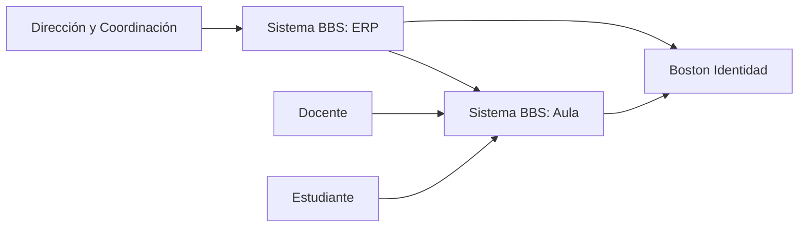
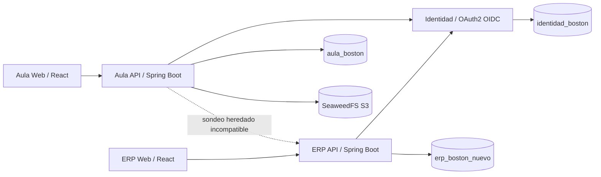
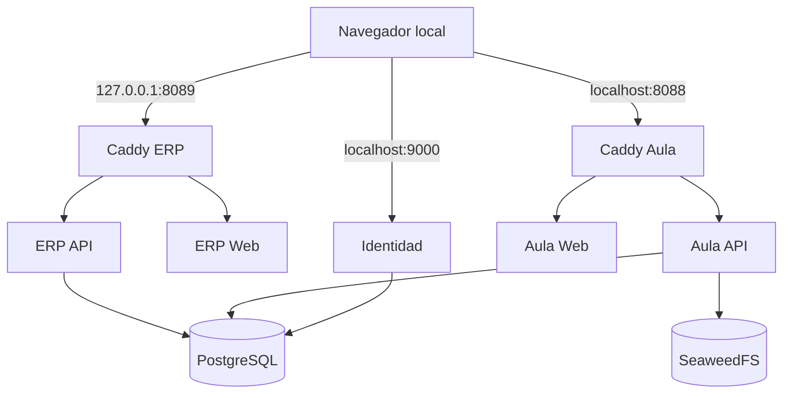

# Arquitectura de Sistema BBS — estado local 2026-11-20

## Alcance y evolución

**Confirmado por código.** Tres procesos Spring Boot independientes: Identidad emite credenciales OIDC/JWT, ERP conserva la fuente institucional de personas, matrículas y oferta, y Aula conserva los datos pedagógicos. Hay dos aplicaciones React y un almacenamiento S3 compatible. PostgreSQL aloja tres bases lógicas separadas. No hay despliegue productivo. La sincronización efectiva del ERP nuevo hacia Aula e Identidad está pendiente.

**Estado anterior:** tres backends, dos frontends, Docker Compose y bases separadas ya existían; el ERP concentraba controladores y reglas en `ErpV1Service` e `Institucional`. **Estado actual:** el ERP nuevo usa siete módulos y la base `erp_boston_nuevo`; Aula 01 extrae inicialmente el cliente/consumidor ERP al paquete `integraciones` y la navegación Web a `src/app`. Véase el [informe Aula 01](../aula/INCREMENTO_AULA_01_2026-11-20.md). Los paquetes restantes del Aula son diseño objetivo, no implementación realizada.

## C4, contexto

## C4, contenedores y dependencias

El consumidor heredado de Aula consulta `/api/erp/v1/eventos`, ruta que no publica el ERP nuevo en el corte revisado. El ERP nuevo registra solicitudes externas `PENDIENTE_NO_CONECTADO`; no se han acreditado cursos o cuentas creados por ese mecanismo. No hay transacción distribuida entre servicios. Las credenciales de navegador del ERP y Aula usan cookies diferentes; las bases no se consultan directamente entre sí.

## Despliegue local

El proyecto Compose conserva `name: boston-aula` para reutilizar sus volúmenes. Puertos publicados sólo en loopback. Véase [operación](../operacion/README.md).

## Stack comprobado en archivos

| Componente | Versión configurada | Evidencia |
|---|---:|---|
| Java | 25; Temurin 25 en Docker | tres `pom.xml`, tres `Dockerfile` |
| Spring Boot | 4.1.2 | tres `pom.xml` |
| Spring Modulith | 2.1.2, sólo ERP | `apps/erp/api/pom.xml`; Aula usa un test de límites con ArchUnit para el piloto |
| PostgreSQL | 18.6 Alpine | `compose.yaml` |
| React / React Router ERP | 19.3.1 / 7.18.4 | `apps/erp/web/package.json` |
| TypeScript / Vite ERP | 7.0.2 / 8.3.4 | `apps/erp/web/package.json` |
| Node ERP Web Docker | 22 Alpine | `apps/erp/web/Dockerfile` |
| Caddy / SeaweedFS | 2.10 Alpine / 4.06 | `compose.yaml` |

## Decisiones arquitectónicas

**ADR-001 — Mantener tres servicios y tres bases.** El ERP es un monolito modular de siete áreas; Identidad y Aula conservan sus límites de proceso y base. Los módulos internos no se convierten en microservicios. Confirmado por `compose.yaml` y el código.

**ADR-002 — Mantener límites de integración.** ERP, Aula e Identidad conservan APIs y bases separadas. Aula 01 no altera contratos HTTP ni la secuencia persistida del consumidor heredado. El contrato que reemplazará `/api/erp/v1/eventos` sigue pendiente para Aula 02; no se debe declarar la sincronización como operativa.

**ADR-003 — Conservar el nombre Compose.** La carpeta de código cambió; `name: boston-aula` no cambió para preservar la identidad de volúmenes. Cambiarlo requeriría una migración planificada y restauración probada.

**ADR-004 — Migración a Java 25.** Se usa Temurin 25 y Spring Boot 4.1.2. La extracción interna de Aula 01 conserva esta base técnica.

**Pendiente de decisión:** políticas institucionales de Documentos; política definitiva de expiración de sesiones para producción; reglas de retención y acceso por recurso. Los valores locales actuales son operativos, no decisiones aprobadas.

## Documentación histórica

`docs/historico/` conserva la documentación anterior como evidencia. `docs/historico/ESTADO_MAESTRO_BOSTON.md` se movió sin alterar contenido. Sus afirmaciones deben contrastarse con el código y los documentos vigentes antes de considerarlas actuales.
