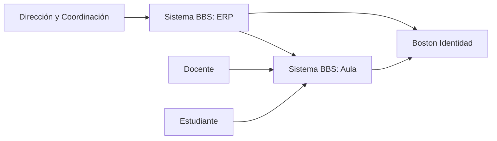
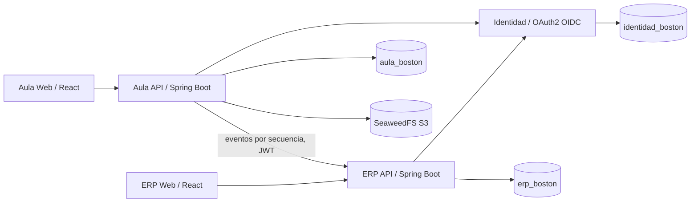
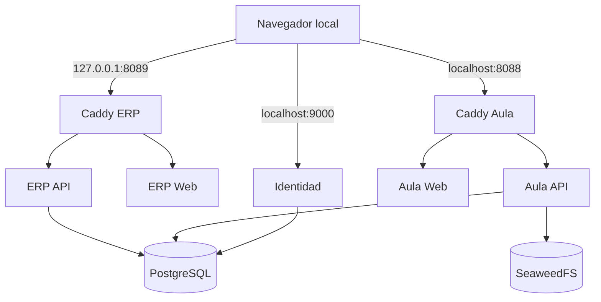

# Arquitectura de Sistema BBS — estado local 2026-11-03

## Alcance y evolución

**Confirmado por código.** Tres procesos Spring Boot independientes: Identidad emite credenciales OIDC/JWT, ERP conserva la fuente institucional de personas, matrículas y oferta, y Aula consume los eventos del ERP para habilitar sus cursos. Hay dos aplicaciones React y un almacenamiento S3 compatible. PostgreSQL aloja tres bases lógicas separadas. No hay despliegue productivo.

**Estado anterior:** tres backends, dos frontends, Docker Compose y bases separadas ya existían; el ERP concentraba controladores y reglas en `ErpV1Service` e `Institucional`. **Estado actual:** raíz `sistema-bbs`, aplicaciones reubicadas, Java 25, Spring Modulith con cinco paquetes funcionales y verificación de dependencias. La extracción de las reglas del servicio legado sigue pendiente.

## C4, contexto

## C4, contenedores y dependencias

El ERP publica cambios institucionales en `eventos_pendientes` dentro de su transacción; Aula consulta el flujo y sincroniza su propia base. No hay transacción distribuida entre servicios. Las credenciales de navegador del ERP y Aula usan cookies diferentes; las bases no se consultan directamente entre sí.

## Despliegue local

El proyecto Compose conserva `name: boston-aula` para reutilizar sus volúmenes. Puertos publicados sólo en loopback. Véase [operación](../operacion/README.md).

## Stack comprobado en archivos

| Componente | Versión configurada | Evidencia |
|---|---:|---|
| Java | 25; Temurin 25 en Docker | tres `pom.xml`, tres `Dockerfile` |
| Spring Boot | 4.1.2 | tres `pom.xml` |
| Spring Modulith | 2.1.2, sólo ERP | `apps/erp/api/pom.xml` |
| PostgreSQL | 18.6 Alpine | `compose.yaml` |
| React / React Router ERP | 19.3.1 / 7.18.4 | `apps/erp/web/package.json` |
| TypeScript / Vite ERP | 7.0.2 / 8.3.4 | `apps/erp/web/package.json` |
| Node ERP Web Docker | 22 Alpine | `apps/erp/web/Dockerfile` |
| Caddy / SeaweedFS | 2.10 Alpine / 4.06 | `compose.yaml` |

## Decisiones arquitectónicas

**ADR-001 — Mantener tres servicios y tres bases.** El ERP es un monolito modular; Identidad y Aula conservan sus límites de proceso y base. Evita convertir los cinco dominios ERP en microservicios. Confirmado por `compose.yaml` y el código.

**ADR-002 — Mantener contratos de integración.** Las rutas `/api/erp` y `/api/erp/v1` permanecen. El flujo outbox sigue en `Institucional`; su traslado a módulos debe preservar secuencia y versión. Confirmado por controladores y migraciones.

**ADR-003 — Conservar el nombre Compose.** La carpeta de código cambió; `name: boston-aula` no cambió para preservar la identidad de volúmenes. Cambiarlo requeriría una migración planificada y restauración probada.

**ADR-004 — Migración a Java 25.** Se usa Temurin 25 y Spring Boot 4.1.2 estable. Aula e Identidad sólo reciben cambios de toolchain y rutas.

**Pendiente de decisión:** políticas institucionales de Documentos; política definitiva de expiración de sesiones para producción; reglas de retención y acceso por recurso. Los valores locales actuales son operativos, no decisiones aprobadas.

## Documentación histórica

`docs/historico/` conserva la documentación anterior como evidencia. `docs/historico/ESTADO_MAESTRO_BOSTON.md` se movió sin alterar contenido. Sus afirmaciones deben contrastarse con el código y los documentos vigentes antes de considerarlas actuales.
