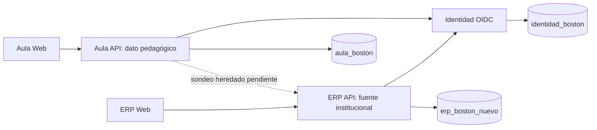

# Aula 01 — estabilización y modularización inicial

**Corte local:** 20/11/2026. **Resultado:** implementación y pruebas del piloto completadas; validación visual y operaciones académicas autenticadas quedan pendientes de revisión manual. No es un cierre del MVP ni de la integración ERP–Aula–Identidad.

## 1. Punto de partida y protección

| Evidencia antes de editar | Resultado |
|---|---|
| `git branch --show-current` | `main` |
| `git rev-parse HEAD` | `a90fc19c645c06b378a96acb1e09484c151f88f6` |
| `git status --short`, `git diff --stat` y revisión selectiva de `git diff` | 14 archivos ERP modificados; `CAMBIOS_DESPUES_DE_DESARROLLO_PARCIAL.md`, migración ERP `V5__personas_registros_erroneos.sql` y una prueba de Matrículas sin seguimiento. La bitácora y el diff describen correcciones de CSRF, oferta, Personas y duplicidad de matrícula. |
| Rama creada sin descartar el árbol sucio | `codex/aula-01-2026-11-20`, desde el mismo HEAD. Los cambios ERP permanecen sin confirmar e intactos. |
| Servicios y persistencia | Compose `boston-aula`; `pg_data` montado en `/var/lib/postgresql`, `s3_data` en `/data`; los servicios existentes estaban activos. |

No se ejecutaron reset, limpieza, commit, push, fusiones, cambios de esquema ni borrado de datos. No se editaron ERP, Identidad, migraciones, `compose.yaml`, secretos o la bitácora del usuario. Antes de reconstruir únicamente `api-aula` y `frontend`, se guardó un respaldo lógico de `aula_boston` en `C:\Users\cueva\AppData\Local\Temp\aula01_pre_rebuild_20261120.dump` (149 229 bytes). Las 25 migraciones Flyway exitosas y `estado_sincronizacion.ultima_secuencia=436` se conservaron después del arranque.

## 2. Línea base y resultado final

| Comando o comprobación | Antes de cambios | Después de cambios |
|---|---|---|
| `mvn -B -ntp -f apps/aula/api/pom.xml verify` | PASS: 16 pruebas, 0 fallos, 0 errores | PASS: 21 pruebas, 0 fallos, 0 errores |
| `npm ci` en `apps/aula/web` | PASS: 43 paquetes, 0 vulnerabilidades informadas | PASS: 43 paquetes, 0 vulnerabilidades informadas |
| `npm run test` en `apps/aula/web` | NO EXISTÍA el script | PASS: 3 pruebas de navegación |
| `npm run build` en `apps/aula/web` | PASS: TypeScript y Vite | PASS: TypeScript y Vite, 176 módulos transformados |
| `docker compose config --quiet` | PASS | PASS |
| `git diff --check` para los archivos de Aula/CI/documentación | Sin cambios de Aula | PASS |
| Compose y `http://localhost:8088/` | Contenedores existentes activos; no se tomó medición HTTP inicial en este incremento | `api-aula` saludable; interfaz HTTP 200 tras reconstruir solo `api-aula` y `frontend` |
| Login OIDC local con cuentas ficticias existentes | NO EJECUTADO como línea base | PASS: sesión HTTP 200 para Docente y Estudiante, rol correcto en `/api/sesion`, `/api/aula/cursos` responde una lista vacía en ambos casos |
| GitHub Actions | NO EJECUTADO | NO EJECUTADO: no hubo commit ni push; el job nuevo solo se comprobó mediante los mismos comandos locales |
| Navegación visual en navegador y escritura académica con curso asignado | NO EJECUTADO | NO EJECUTADO: queda como recorrido manual; no hay inscripciones ni asignaciones proyectadas en la base Aula actual |

En una ejecución intermedia, la compilación de una prueba Java falló por una llamada ambigua a `JdbcTemplate.update` con un matcher Mockito sin tipo. Se corrigió el matcher a `any(Object.class)` y la ejecución completa posterior terminó con 21/21 pruebas correctas. El `WARN` con `ERP: HTTP 404` durante `SincronizacionTest` es el error **simulado intencionalmente** para verificar que no se declara éxito ni se avanza la secuencia; no es un fallo de la suite.

## 3. Extracción realizada y contratos preservados

| Antes | Después | Protección |
|---|---|---|
| `pe.boston.aula.ErpCliente` y `pe.boston.aula.Sincronizacion` | `pe.boston.aula.integraciones` | Mismo cliente `client_credentials`, URL heredada, sondeo `fixedDelay=15000`/`initialDelay=3000`, transacción por evento, secuencia e indicadores de error/éxito. Solo cambiaron paquete e importaciones consumidoras. |
| Menús, títulos y 17 declaraciones de ruta dentro de `web/src/main.tsx` | `web/src/app/navegacion.ts`; `main.tsx` renderiza el inventario de rutas | Mismos textos, orden, URLs, menús por perfil, filtro de clases y entrada Developer. La autorización sigue en API y páginas, no en el menú. |

La API conserva 30 clases Java productivas en total: 2 ahora en `integraciones`, las demás en el paquete raíz. No se dividieron `CursosYTareas`, `ArchivosAcademicos`, las páginas grandes ni `style.scss`. El flujo y las bases siguen separados:

### Cambios de código y CI

- API: `apps/aula/api/pom.xml`; traslado a `apps/aula/api/src/main/java/pe/boston/aula/integraciones/{ErpCliente,Sincronizacion}.java`; importaciones ajustadas en `CursosYTareas`, `EstadoCuentaFiltro`, `GrabacionesYoutube`, `HistorialAcademicoController`, `OperacionesController`, `PerfilController` y `SupervisionController`.
- Pruebas API: `SincronizacionTest.java` amplía consumo, reintento y ausencia de avance falso; `IntegracionesSpringTest.java` verifica descubrimiento de un bean por tipo y una sola anotación `@Scheduled`; `integraciones/IntegracionesArquitecturaTest.java` comprueba que la integración no dependa de clases internas del paquete raíz y demuestra que el límite detecta una dependencia prohibida. Se ajustó el import de `CursosYTareasTest.java`. ArchUnit 1.4.2 se añadió solo para pruebas; no se agregó Spring Modulith a Aula.
- Web: `apps/aula/web/src/app/navegacion.ts`, `navegacion.test.mjs`, `src/main.tsx` y `package.json`. Las pruebas usan `node:test` de Node 24, sin dependencia adicional ni cambio de lockfile.
- CI: `.github/workflows/ci.yaml` incluye job `aula-web` con Node 24, caché npm, `npm ci`, `npm run test` y `npm run build`; el job Java existente sigue ejecutando Aula API.
- Documentación vigente: `docs/aula/README.md`, `docs/arquitectura/README.md` y este informe. `docs/historico` no se editó.

## 4. Brechas y riesgos que continúan

| ID | Evidencia actual | Siguiente incremento |
|---|---|---|
| INT-01 | `Sincronizacion` consulta `/api/erp/v1/eventos?despues=...`; los controladores del ERP nuevo no publican esa ruta. El ERP registra solicitudes `PENDIENTE_NO_CONECTADO`. En Aula, la secuencia 436 procede del flujo anterior y hay un error de sincronización registrado. El cliente heredado usa token de servicio, mientras las rutas ERP nuevas exigen acceso institucional humano. El login de prueba sí funciona, pero `/api/aula/cursos` devuelve 0 para Docente y Estudiante; crear cuentas no equivale a aprovisionar cursos. | **Aula 02:** contrato ERP→Aula→Identidad con autenticación de servicio, idempotencia, reconciliación, reintentos, estados confirmados por el destino y prueba E2E. No se inventó endpoint ni se marcó éxito. |
| INT-02 | `UsuarioActual.estudianteCurso` requiere inscripción activa y curso vigente. El historial actual no satisface la lectura del estudiante con matrícula `Finalizada` exigida por AF-Q06; `Retirada` tampoco debe recuperar acceso. | **Aula 03:** separar permisos de lectura histórica y escritura activa, con casos por estado y año. |
| INT-03 | Menús `ADMINISTRADOR`/`COORDINACION` y rutas `/usuarios`, `/modulos`, `/pagos` siguen presentes. `ErpAdministracionController` expone la pasarela `/api/aula/administracion-erp` hacia operaciones institucionales anteriores, incluidas tesorería; `CuentasRemotasController` reenvía gestión de cuentas a Identidad. Su uso actual completo no quedó demostrado. | Inventariar consumidores y decidir conservar, redirigir o retirar en un incremento posterior. Ninguna ruta fue eliminada en Aula 01. |
| SEG-01/02 | `AULA_SESSION` y tiempo Spring configurados con `2147483647s`; `EstadoCuentaFiltro` consulta Identidad para revocación y responde 503 cuando no puede verificar. | Decidir y probar expiración, revocación y disponibilidad sin degradar la seguridad. Antes de datos reales: secretos, TLS, retención, acceso a archivos y restauración de copias. |
| Alcance institucional | Asistencia y Atención institucional corresponden a procesos cuya fuente de verdad es ERP. La mensajería actual del Aula no demuestra el flujo institucional Libre/Ocupada. | Definir sus contratos con ERP; no crear modelos paralelos en Aula. |

**Mapa modular objetivo, no terminado:** API `plataforma`, `integraciones`, `academico`, `actividades`, `recursos`, `clases`, `comunicacion`, `perfil`; Web `app`, `features`, `shared`, `styles`. El piloto de este incremento implementa solo `integraciones` y `app/navegacion.ts`; las demás ubicaciones son destino gradual.

## 5. Prueba manual en el navegador

1. Abrir <http://localhost:8088/> con Docker local encendido. Se debe mostrar el acceso del Aula. Usar una cuenta ficticia de Docente y otra de Estudiante; las contraseñas no se guardan en este documento. Las dos cuentas de prueba entregadas al responsable el 20/11/2026 pasaron OIDC en una sesión HTTP aislada.
2. Como **Docente**, comprobar que el menú contiene `Mis cursos`, `Tareas y entregas`, `Calificaciones` y `Mi cuenta`, y no muestra `Mis pagos` ni administración. Abrir `/cuenta`, volver a Inicio y cerrar sesión.
3. Como **Estudiante**, comprobar `Mis cursos`, `Mis tareas`, `Mis notas`, `Mis pagos` y `Mi cuenta`, sin menús de administración. Abrir `/cuenta`, volver y cerrar sesión.
4. En este corte, las dos cuentas muestran **0 cursos** porque las proyecciones ERP→Aula no están conectadas. No probar entregas, notas o clases como si la matrícula y asignación nuevas ya estuvieran sincronizadas. Para una revisión funcional completa de esas operaciones se requieren cursos/inscripciones autorizados y el contrato Aula 02.
5. Si una página falla, registrar perfil, URL, acción, mensaje y captura. La comprobación HTTP realizada por Codex acredita servicio y sesiones, no sustituye la inspección visual del usuario.

No hubo commit, push ni PR. El árbol conserva las correcciones ERP previas y los cambios Aula 01 quedan disponibles en la rama local para revisión.
