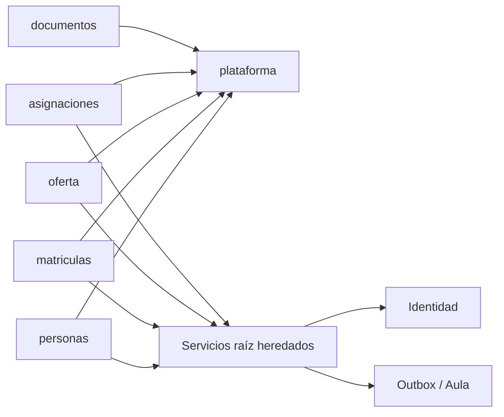

# ERP — módulos, datos, contratos y seguridad

## Dependencias actuales

`ApplicationModules.verify()` pasa para los cinco paquetes funcionales. **Límite de esta verificación:** los servicios raíz `ErpV1Service` e `Institucional` concentran aún reglas y SQL de varios dominios; el test no demuestra propiedad exclusiva de tablas ni hexagonalidad plena. Las fachadas actuales extraen tres consultas públicas; los controladores V1 se separaron por dominio, conservando rutas. `plataforma` aloja acceso académico y filtro de sesión; Spring Modulith lo detecta como módulo de soporte permitido. No se creó un sexto módulo funcional.

## Responsabilidades y propiedad de datos

| Módulo | Paquetes/casos actuales | Tablas principales | Estado |
|---|---|---|---|
| Personas | `personas/api`, `PersonasFacade`; consultas de alumnos/personas, alta, verificación, vínculos | `personas`, `estudiantes`, `apoderados`, `vinculos_estudiante_apoderado` | Parcialmente extraído; escrituras en `ErpV1Service` |
| Matrículas | `matriculas/api`, `BorradoresMatricula`, `ImportacionMatriculas`; borrador, inscripción, transición, importación | `matriculas`, `borradores_matricula`, `historial_matriculas`, `importaciones_matriculas` | Borrador/importación en módulo; transiciones V1 en raíz |
| Oferta académica | `oferta/api`, `OfertaFacade`; currículo, períodos, grados, secciones, oferta | `periodos_academicos`, `niveles_educativos`, `grados`, `secciones`, `asignaturas`, `asignaturas_grado`, `ofertas_academicas` | Consulta extraída; escrituras en raíz |
| Asignaciones docentes | `asignaciones/api`, `AsignacionesFacade`; docentes, cuentas, asignación | `docentes`, `asignaciones_docentes` | Consulta extraída; escrituras en raíz |
| Documentos | `documentos/package-info.java`; diseño delimitado | `referencias_documentales` (metadatos) | Estructura; requisitos sin aprobar, sin API completa |

**Tablas compartidas/infraestructura:** `auditoria_erp`, `eventos_pendientes`, `versiones_eventos`, `ambitos_coordinacion`, `spring_session`, `spring_session_attributes`, `oauth2_authorized_client`. Tesorería heredada conserva `conceptos_cobro`, `obligaciones_pago`, `pagos`, `aplicaciones_pago`; no mover ni eliminar sin proyecto independiente. La propiedad de tablas refleja intención arquitectónica; el código heredado todavía las usa de forma transversal.

## Diccionario breve

- `personas`: identidad civil (UUID, nombres, apellidos, tipo/número de documento, contacto). `estudiantes`, `apoderados`, `docentes` extienden por referencia a `persona_id`.
- `estudiantes`: identidad académica y código institucional que puede ser nulo antes de concluir matrícula.
- `vinculos_estudiante_apoderado`: relación, rol, contacto de emergencia y contacto actualizado.
- `matriculas`: alumno, período, grado, sección opcional en trámite, procedencia, estado, versión, responsable financiero y datos de pago externo; índice único alumno/período.
- `borradores_matricula`: datos JSON privados por actor, paso 1–4, matrícula asociada tras finalización. El JSON se vacía al finalizar.
- `historial_matriculas`: actor, acción, valores antes/después e instante; no reemplaza auditoría de otras entidades.
- `asignaturas`: catálogo institucional y código. `asignaturas_grado`: relación con grado y período opcional, orden y vigencia. `ofertas_academicas`: curso concreto por sección.
- `asignaciones_docentes`: docente y oferta, estado y marcas temporales.
- `referencias_documentales`: UUID de estudiante o matrícula, tipo, versión, clave privada, nombre, MIME, estado y actor. La tabla existe; no demuestra políticas de retención ni carga autorizada.
- `eventos_pendientes`: outbox por secuencia y entidad. `versiones_eventos`: contador de versiones para sincronización.

Migraciones históricas V1–V11 ERP no se editaron. El modelo efectivo se obtiene aplicándolas en orden; estos resúmenes no sustituyen las restricciones SQL. Fuentes: `apps/erp/api/src/main/resources/db/migration/`.

## API y roles

La API institucional `/api/erp/**` usa JWT; `/api/erp/eventos/**` exige `SCOPE_erp.sync` en la cadena de seguridad. La Web usa OAuth2/OIDC y su BFF `/api/erp-web/v1/**`, con CSRF de SPA habilitado. Los métodos V1 llaman controles `lectura`, `escritura` o `direccion`; los permisos de la API heredada están en `Institucional.admin`. Consultar el código para cada operación, pues esta matriz no sustituye una auditoría exhaustiva:

| Operación | Dirección | Coordinación | Servicio de sincronización |
|---|---|---|---|
| Leer datos académicos V1 | Según `AccesoAcademico.lectura` | Según ámbito/rol en código | No por defecto |
| Crear/editar V1 | Según `AccesoAcademico.escritura` | Según `AccesoAcademico.escritura` | No por defecto |
| Alta de período/nivel/grado y acciones reservadas | Según `direccion` | Rechazada donde se invoca `direccion` | No |
| Leer `/api/erp/eventos` | Por alcance JWT, no por perfil web | Por alcance JWT | Sí, con `erp.sync` |

**Riesgo vigente:** muchos métodos reciben un UUID de recurso y hacen comprobación de rol general; la autorización específica por alumno, período y ámbito necesita pruebas de IDOR por endpoint antes de una operación pública.

## Modelo de amenazas y controles observados

| Amenaza | Control existente | Brecha/prueba necesaria |
|---|---|---|
| Suplantación/uso de token | JWT con emisor y JWK, OIDC | Probar expiración y revocación extremo a extremo |
| Sesión perpetua | Timeout de inactividad configurable, filtro absoluto ERP, cookie HttpOnly/SameSite Lax | Definir duración institucional; probar login/logout tras rebuild |
| CSRF en BFF | `csrf(c -> c.spa())` | Probar POST sin/con token |
| Acceso a alumno ajeno | Comprobaciones de rol/ámbito en métodos | Matriz por recurso y pruebas IDOR |
| Fuga de secretos | `.env` y cuentas iniciales ignorados | Revisar CI y rotación antes de producción |
| SQL/archivo malicioso | Consultas parametrizadas predominantes y validaciones por caso | Añadir pruebas negativas de entrada e importación |
| Pérdida de trazabilidad | `auditoria_erp`, `historial_matriculas`, outbox | Revisión de cada operación sensible |

Los valores locales `BOSTON_ERP_SESSION_TIMEOUT=12h`, cookie máximo 12h y límite absoluto 24h son configurables. `BOSTON_ERP_COOKIE_SECURE=false` sólo para HTTP loopback; una futura instalación HTTPS deberá usar `true` y política aprobada.

## Limpieza y mantenimiento

**Conservar:** migraciones aplicadas, contratos `/api/erp`, outbox, Tesorería legada, documentos históricos. **Refactorizar:** `ErpV1Service`, `Institucional`, consultas SQL transversales, tipos `Map<String,Object>` de respuestas y formularios grandes del Web. **Archivar:** documentación anterior en `docs/historico`. **Eliminar:** sólo el controlador V1 original sobredimensionado fue reemplazado por controladores de módulo; no se borraron capacidades ni tablas. No se afirma que toda la limpieza esté finalizada.
