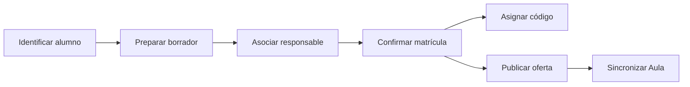

# ERP: casos de uso

**Corte 2026-11-04.** Estos son flujos observados, no una política nueva. [SRS](REQUISITOS_SRS.md) define los resultados verificables y [reglas](REGLAS_INSTITUCIONALES.md) distingue aprobaciones.

| Caso | Actor observado | Camino principal | Variantes / errores que deben preservarse | Código y pruebas |
|---|---|---|---|---|
| CU-01 Identificar alumno | Dirección/Coordinación | Buscar o verificar DNI; mostrar ficha e historial. | Documento duplicado, ficha preliminar, proceso activo y alumno previo. | `ErpV1Service.verificarEstudiante`, C01–C02. |
| CU-02 Asociar responsable | Dirección/Coordinación | Reutilizar o crear persona; vincular al alumno como principal. | El principal anterior pasa a segundo; mismo documento reutiliza persona. | [PersonasService](../../apps/erp/api/src/main/java/pe/boston/erp/personas/application/PersonasService.java), C03. |
| CU-03 Preparar matrícula | Dirección/Coordinación | Guardar pasos 1–4 en borrador privado, volver/continuar y finalizar. | Otro operador no ve el borrador; finalizar repetido retorna mismo ID; datos borrados al finalizar. | `BorradoresMatricula`, C04. |
| CU-04 Resolver matrícula | Dirección/Coordinación | Iniciar proceso, reservar, editar, confirmar y registrar pago externo. | Cancelación de pendiente, matrícula duplicada, responsable ausente, pago duplicado; código sólo al confirmar. | `ErpV1Service.iniciarMatricula/confirmar/registrarPagoExterno`, C05–C07. |
| CU-05 Publicar malla | Dirección | Crear relación asignatura–grado y propagar ofertas a secciones habilitadas. | Catálogo inactivo, grado/periodo inválido, edición y retiro condicionados. | `ErpV1Service.vincularAsignatura`, C08. |
| CU-06 Asignar docente | Dirección en V1 | Registrar docente y asociarlo a una oferta; publicar cambio. | Docente sin cuenta permitido; lote deduplicado; cuenta remota inválida/fallo aún sin compensación. | `ErpV1Service.asignarDocenteLote`, C09 parcial. |
| CU-07 Sincronizar Aula | Cuenta con `erp.sync` | Leer outbox desde última secuencia y aplicar evento/version. | Rollback no publica; reintento conserva secuencia y versiones; recepción completa pendiente de prueba. | `Institucional.publicarOferta`, `Sincronizacion`, C11. |
| CU-08 Administrar Tesorería heredada | Administración con permiso financiero | Consultar obligaciones/pagos y registrar movimientos. | Fuera de los cinco módulos; contrato activo desde Aula. | [TesoreriaController](../../apps/erp/api/src/main/java/pe/boston/erp/TesoreriaController.java), [Aula](../../apps/aula/api/src/main/java/pe/boston/aula/ErpAdministracionController.java). |

El orden operativo real del asistente está en [BorradoresMatricula](../../apps/erp/api/src/main/java/pe/boston/erp/matriculas/BorradoresMatricula.java) y [AsistenteMatricula](../../apps/erp/web/src/modules/matriculas/pages/AsistenteMatricula.tsx). No se define aquí un caso documental: la tabla existente no equivale a un flujo aprobado.
