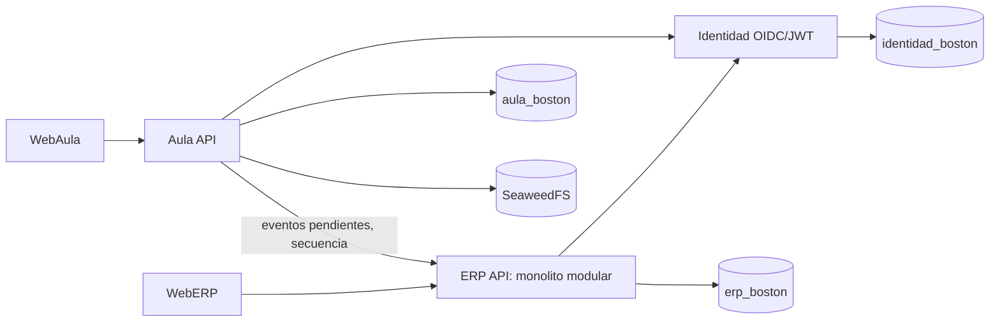

# Entrega para ChatGPT — reestructuración de Sistema BBS

**Fecha:** 2026-11-03. **Estado general: parcial y operativo localmente.** Este documento describe el código y las comprobaciones realizadas; no declara terminadas pruebas o políticas pendientes.

## A. Identificación y línea base

- Rama inicial `main`, commit inicial `edb8b3bf52dd938fa7c062f553e7fd377c89d460`, árbol limpio. Rama de trabajo local `refactor/sistema-bbs-java25`. Sin push ni despliegue remoto. Los cambios de esta reestructuración están en el repositorio local; consultar `git status` para el estado de staging/commit al recibir este documento.
- Ruta final: `C:\Valana-Pruebas\Aula Virtual Boston\sistema-bbs`. Un directorio anterior `boston-aula` puede quedar como remanente vacío con `.git` vacío por un bloqueo de Windows durante el movimiento; el único repositorio funcional es `sistema-bbs/.git`.
- Punto de recuperación externo, fuera de Git: `C:\Valana-Pruebas\Aula Virtual Boston\respaldo-sistema-bbs-20261103`. Incluye dumps personalizados de `identidad_boston`, `erp_boston`, `aula_boston` y copia de datos S3. `pg_restore --list` funcionó y los tres dumps se restauraron en un PostgreSQL 18.6 temporal aislado. No se restauró sobre volúmenes originales.
- `docs/historico/ESTADO_MAESTRO_BOSTON.md` se movió sin editar; SHA256 antes/después `50E49AEE9A081D663C2A537C7D2C74F8FEBD7790DC70D807D78B80E655303DE5`.
- Versiones configuradas: Java 25, Spring Boot 4.1.2 en tres backends, Spring Modulith 2.1.2 en ERP, PostgreSQL 18.6 Alpine, React 19.3.1, React Router 7.18.4, TypeScript 7.0.2 y Vite 8.3.4 en ERP Web. **Versiones observadas en ejecución:** Temurin 25.0.5+8 en tres contenedores Java; Spring Boot 4.1.2 en logs. Evidencias: `pom.xml`, Dockerfiles, `package.json`, `compose.yaml` y `docker compose exec ... java -version`.

## B. Arquitectura resultante



Estructura: `apps/erp/{api,web}`, `apps/aula/{api,web}`, `services/identidad`, `infra`, `docs/{arquitectura,erp,aula,identidad,operacion,historico}`, `tests/legacy`, `scripts`, `.github/workflows`. La arquitectura global y los ADR están en [arquitectura](../arquitectura/README.md).

Backend ERP: cinco paquetes Spring Modulith `personas`, `matriculas`, `oferta`, `asignaciones`, `documentos`; `plataforma` es soporte. Los controladores V1 quedaron en cada paquete. `PersonasFacade`, `OfertaFacade`, `AsignacionesFacade` contienen consultas concretas. `BorradoresMatricula` e `ImportacionMatriculas` están en Matrículas. **Límite:** `ErpV1Service` e `Institucional` en la raíz siguen implementando numerosas escrituras y consultas de varios dominios; no se completó la extracción hexagonal. El test Modulith verifica dependencias Java, no propiedad efectiva de tablas.

Frontend ERP: `src/app/router`, `src/app/pages`, `src/modules/{personas,matriculas,oferta,asignaciones}`, `src/shared/{api,ui}` y `src/main.tsx`. Rutas y comportamiento visibles se preservaron. No hay UI de Documentos por ausencia de requisitos aprobados. Todavía existen pantallas grandes y contratos `Map<String,Object>`/tipos ambiguos en el borde que requieren refactorización posterior.

## C. Cambios realizados

- Movimientos: `api-erp`→`apps/erp/api`, `erp-web`→`apps/erp/web`, `api-aula`→`apps/aula/api`, `frontend`→`apps/aula/web`, `identidad`→`services/identidad`, `infraestructura`→`infra`, `documentacion`→`docs/historico`, `pruebas`→`tests/legacy`. `compose.yaml`, `.gitignore`, README, scripts y Dockerfiles se adaptaron. La documentación histórica permanece intacta.
- `ErpV1Controller` se redujo a resumen y catálogos; se crearon cuatro controladores de módulo con las rutas V1 originales. Los servicios raíz no se eliminaron ni se atribuyen falsamente a un módulo.
- Java y Docker: POM de tres backends en Java 25/Spring Boot 4.1.2; imágenes de construcción Maven 3.9.12 Temurin 25 y runtime Temurin 25. Spring Modulith BOM/starter/test 2.1.2 se incorporó sólo al ERP.
- Seguridad ERP: sesión JDBC con timeout local configurable de inactividad 12 h, cookie máximo local configurable 12 h, límite absoluto configurable 24 h; cookie `ERP_SESSION` HttpOnly y SameSite Lax, Secure parametrizado (`false` sólo HTTP local). `SesionAbsolutaFiltroTest` verifica caducidad/conservación. La API JWT conserva validación de emisor/JWK y el BFF conserva CSRF. **No se ha validado cada caso de autorización/IDOR.** Las duraciones son valores operativos locales, no política institucional aprobada.
- Infraestructura: `name: boston-aula` se conservó para evitar renombrar volúmenes. No se editaron migraciones históricas ni se agregaron nuevas; Flyway validó 6 Identidad, 11 ERP y 25 Aula. El Dockerfile de ERP Web usa `npm ci` y lockfile para instalación reproducible.
- DevOps: `.github/workflows/ci.yaml` compila y prueba los tres backends con Temurin 25, hace build/audit de ERP Web y verifica Compose. No se ha ejecutado en GitHub porque no hubo push. `AGENTS.md` raíz y por aplicación documentan límites y comandos.
- Limpieza: se sustituyó un controlador V1 grande por controladores de dominio; no se borró SQL ni Tesorería legada. Los scripts de división quedan en `scripts/` como registro reproducible de la transformación; no son parte del arranque. Ningún dato, volumen o migración se eliminó.

## D. Cinco módulos ERP

| Módulo | Responsabilidad / paquete | Entidades, tablas y API | Reglas y pruebas / estado real |
|---|---|---|---|
| Personas | Alta, consulta, verificación de alumnos y responsables; `personas/` | `personas`, `estudiantes`, `apoderados`, `vinculos_estudiante_apoderado`; `/api/erp/v1/estudiantes`, `/personas`, `/responsables` | Código institucional al concluir matrícula; verificación por documento. Consulta extraída; escrituras en raíz. Sin pruebas PostgreSQL por caso. |
| Matrículas | Borrador, modalidad, trámite, confirmación, historial, pago externo e importación; `matriculas/` | `matriculas`, `borradores_matricula`, `historial_matriculas`, `importaciones_matriculas`; `/matriculas/**`, `/importaciones/**` | Borrador privado por actor, finalización idempotente por ID, estados/versión. Servicio de borradores y de importación movidos; transiciones V1 aún en raíz. Falta regresión end-to-end automatizada. |
| Oferta académica | Catálogo, malla por grado/período, secciones, ofertas; `oferta/` | `periodos_academicos`, `niveles_educativos`, `grados`, `secciones`, `asignaturas`, `asignaturas_grado`, `ofertas_academicas`; rutas `/periodos`, `/grados`, `/asignaturas`, `/ofertas` | Curso concreto por sección y código de asignatura. Consulta extraída; escrituras en raíz. Falta integración SQL por caso. |
| Asignaciones docentes | Docentes, cuenta de Identidad, asignación a oferta y retiro; `asignaciones/` | `docentes`, `asignaciones_docentes`; `/docentes/**` | Asignación por oferta, no sólo nombre de curso. Consulta extraída; escrituras en raíz. Falta contrato automatizado con Identidad. |
| Documentos | Referencias y futura asociación a alumno/matrícula; `documentos/` | `referencias_documentales` (metadatos) en V4; no API documental completa | **Estructura solamente.** Tipo, versiones y clave privada existen en tabla; faltan reglas aprobadas de carga, estados, acceso y retención. No declarar funcional. |

Diccionario, propiedad efectiva y diagramas están en [arquitectura y datos ERP](ARQUITECTURA_Y_DATOS.md). Tesorería (`Tesoreria.java`, `TesoreriaController.java`, cuatro tablas) queda como legado compatible fuera de los cinco módulos funcionales; no se eliminó.

## E. Compatibilidad

- Identidad y Aula mantienen sus paquetes de negocio, esquemas e interfaces; sólo toolchain y rutas locales cambiaron. Sus pruebas Maven pasaron. Se conservaron tres bases separadas y UUID institucionales.
- Los prefijos `/api/erp`, `/api/erp/v1` y `/api/erp-web/v1` siguen disponibles. La API arranca sin conflictos de mappings. El endpoint BFF sin sesión respondió 401 en comprobación local.
- ERP–Aula sigue usando outbox y sincronización, pero **no se ejecutó un flujo completo autenticado que cree matrícula y confirme la recepción en Aula** en esta reestructuración. Tampoco se simuló fallo parcial/reintento; considerarlo riesgo de compatibilidad hasta esa prueba.
- OpenAPI actual en [contratos](CONTRATOS_API.md) y [esquema tipado parcial](openapi.yaml). No afirmar cobertura completa: algunas respuestas siguen siendo mapas dinámicos. El OpenAPI histórico contiene esquemas genéricos.

## F. Calidad y seguridad

| Evidencia ejecutada | Resultado | Límite |
|---|---|---|
| `mvn -q test` ERP con JDK 25 | 14 pruebas, 0 fallos; incluye `ApplicationModules.verify()`, dos casos de límite absoluto de sesión y migración Flyway V1–V11 con Testcontainers/PostgreSQL 18.6 | No cubre todos los casos de uso |
| `mvn -q test` Aula e Identidad con JDK 25 | Ambos comandos exit 0 | No sustituye prueba de integración entre servicios |
| `npm ci` y `npm run build` ERP Web | Instalación y TypeScript/Vite correctos | Sin pruebas de interacción de formularios |
| `docker compose config --quiet` | exit 0 | Configuración, no flujo funcional |
| Restauración aislada de tres dumps | Exit 0; Flyway 6/11/25 presente en copia | No implica backup automático |
| Reconstrucción y arranque Compose | 9 servicios arriba; PostgreSQL, S3, Identidad, ERP API y Aula API sanos | Web no tiene healthcheck propio |
| HTTP local | ERP 200, Aula 200, Identidad salud 200, BFF ERP sin sesión 401 | S3 raíz anónima 403 esperado; login funcional no probado |

No hay cobertura porcentual configurada. La prueba Testcontainers valida la aplicación de las 11 migraciones en una base vacía y la presencia de tablas clave; no cubre la migración de una base histórica con datos. No se ejecutaron en esta fase la batería E³ de flujos, pruebas de componentes críticos del Web, IDOR, CSRF por operación ni recuperación de fallos de sincronización. No se deshabilitaron controles para pasar pruebas. Revisar [requisitos y matriz](REQUISITOS_Y_TRAZABILIDAD.md) y [seguridad](ARQUITECTURA_Y_DATOS.md).

## G. Ejecución local y recuperación

Servicios arriba tras `docker compose up -d --build`: `postgres`, `seaweedfs`, `identidad`, `api-erp`, `api-aula`, `erp-web`, `frontend`, `erp-proxy`, `proxy`. URL ERP `http://127.0.0.1:8089`, Aula `http://localhost:8088`, Identidad `http://localhost:9000`. PostgreSQL del volumen original conserva en la comprobación 30 tablas ERP, 1 alumno y 2 matrículas; esos conteos son foto del momento, no datos de prueba nuevos de esta tarea.

```powershell
cd 'C:\Valana-Pruebas\Aula Virtual Boston\sistema-bbs'
docker compose config --quiet
docker compose up -d --build
docker compose ps
mvn -q -f apps/erp/api/pom.xml test
npm ci --prefix apps/erp/web
npm run build --prefix apps/erp/web
docker compose stop
```

El procedimiento seguro de backup, restauración en copia aislada, diagnóstico y reversión está en [operación](../operacion/README.md). No usar `down -v`, reset/clean de Git ni restaurar encima de volúmenes activos.

## H. SDLC y continuación del curso

Estado: base estructural y ejecución local verificadas; transición de arquitectura aún en curso. Documentos nuevos: [arquitectura](../arquitectura/README.md), [requisitos/SRS y trazabilidad](REQUISITOS_Y_TRAZABILIDAD.md), [datos/seguridad](ARQUITECTURA_Y_DATOS.md), [contratos](CONTRATOS_API.md), [operación](../operacion/README.md) y este informe. `docs/historico/` aporta evidencia previa, no una especificación vigente por sí sola.

Prioridades para el siguiente ciclo de ingeniería: (1) aprobar PRD y reglas institucionales de Documentos y sesión; (2) extraer escrituras de `ErpV1Service`/`Institucional` a casos de uso por módulo y comprobar propiedad de tablas; (3) generar OpenAPI completo desde tipos concretos; (4) cubrir matrículas, oferta, asignaciones, seguridad por recurso e integración ERP–Aula con PostgreSQL aislado; (5) definir operación y seguridad de una futura producción. ChatGPT no debe suponer que Documentos, políticas de retención, permisos finos o sincronización con fallos están terminados.

## I. Resumen ejecutivo

Se conservaron datos, volúmenes, tres bases, migraciones, APIs e historial. Se rehízo la distribución física del repositorio y la estructura de controladores ERP/Web; se añadió Java 25, Modulith, prueba de límites, CI y documentación vigente. Se eliminó la concentración del controlador V1, pero **no** la de los dos servicios raíz. El sistema está funcionando localmente; el estado global sigue **parcial** hasta extraer lógica de dominio y verificar flujos críticos completos. No hubo push ni cambios de producción.
