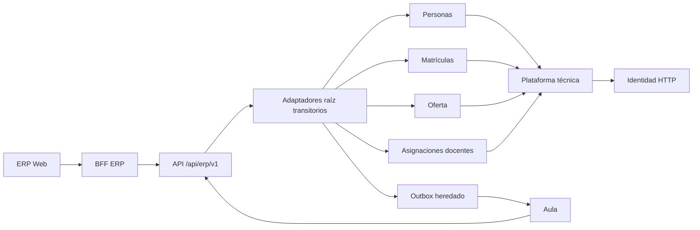

# ERP: mapa de módulos y puertas de verificación

**Estado al 2026-11-04:** extracción parcial. Este documento es la referencia vigente de límites; [el plan de Fase 1](PLAN_MODULARIZACION.md) conserva el análisis previo.

Los cinco módulos funcionales son `personas`, `matriculas`, `oferta`, `asignaciones` y `documentos`; `plataforma` contiene seguridad, proxy, errores e integración técnica. Las ubicaciones actuales son [ERP API](../../apps/erp/api/src/main/java/pe/boston/erp/) y [ERP Web](../../apps/erp/web/src/). `ApplicationModules.verify()` detecta los cinco, pero no demuestra aún propiedad exclusiva de SQL. El controlador [PersonasController](../../apps/erp/api/src/main/java/pe/boston/erp/PersonasController.java) permanece temporalmente en raíz para evitar el ciclo Personas → `ErpV1Service` → Personas mientras sus consultas de verificación y ficha dependan de la raíz. [IntegracionV1Controller](../../apps/erp/api/src/main/java/pe/boston/erp/IntegracionV1Controller.java) también queda en raíz mientras dependa de `Institucional`.

| Módulo | Propiedad buscada | Implementación comprobada | Pendiente principal |
|---|---|---|---|
| Personas | Identidad civil, alumno, responsables y vínculos | [Estudiantes](../../apps/erp/api/src/main/java/pe/boston/erp/personas/Estudiantes.java), [Responsables](../../apps/erp/api/src/main/java/pe/boston/erp/personas/Responsables.java), [PersonasService](../../apps/erp/api/src/main/java/pe/boston/erp/personas/application/PersonasService.java), `PersonasFacade` | Alta/edición de alumno ya extraídas; verificación histórica y ficha siguen en `ErpV1Service` por consultas de matrícula. |
| Matrículas | Borrador, proceso, confirmación, historial, importación y pago externo | `BorradoresMatricula`, `ImportacionMatriculas` y controlador V1 | Transiciones y SQL del trámite siguen en `ErpV1Service`; caracterizar C05–C07, C13 por completo. |
| Oferta académica | Periodos, malla, secciones, cursos y catálogo | `OfertaFacade` y controlador V1 | Escrituras en `ErpV1Service`; caracterizar CRUD/propagación C08. |
| Asignaciones docentes | Ficha docente, vínculo a Identidad y asignación de oferta | `AsignacionesFacade` y controlador V1 | Escrituras en `ErpV1Service`; definir recuperación del alta de cuenta antes de extraer HTTP. |
| Documentos | Metadatos y futura gestión documental | [paquete estructural](../../apps/erp/api/src/main/java/pe/boston/erp/documentos/package-info.java) y tabla V4 | Requisitos de carga, acceso, estados y retención sin aprobar; no hay flujo funcional. |

## Cinco verificaciones por módulo

Estados permitidos: **Pendiente, En progreso, Bloqueada, Completada**. Ninguna celda «Completada» implica aprobación institucional de reglas no documentadas. Fecha y referencia de esta matriz: **2026-11-04, rama `refactor/erp-phase2-20261104`**, [pruebas de caracterización](../../apps/erp/api/src/test/java/pe/boston/erp/ContratosErpCaracterizacionTest.java) y [suite modular](../../apps/erp/api/src/test/java/pe/boston/erp/ArquitecturaModularTest.java).

| Módulo | Requisitos | Análisis funcional | Arquitectura | Implementación | Verificación | Decisión pendiente y pruebas |
|---|---|---|---|---|---|---|
| Personas | En progreso: [SRS](REQUISITOS_SRS.md) | En progreso: [casos](CASOS_DE_USO.md) | En progreso: contratos `Estudiantes` y `Responsables` | En progreso: alta/edición y responsables extraídos | En progreso: C01–C03, C04; `mvn test` | Autorización por recurso; C02 con reloj fijo, HTTP y concurrencia. |
| Matrículas | En progreso: SRS | En progreso: casos | En progreso: [ADR](DECISIONES_ARQUITECTURA.md) | En progreso: borradores/importación | En progreso: C04–C07 parciales | Modalidades y pago institucional pendientes; C05–C07 y C13 completos. |
| Oferta | En progreso: SRS | En progreso: casos | En progreso: ADR | En progreso: consulta y V1 | En progreso: C08 parcial | Semántica de periodo y orden; CRUD HTTP y carrera de oferta. |
| Asignaciones | En progreso: SRS | En progreso: casos | Bloqueada: coordinación de Identidad | En progreso: consulta y V1 | En progreso: C09 parcial | Idempotencia/reconciliación de cuenta; simulación de fallo HTTP. |
| Documentos | Bloqueada: reglas no aprobadas | Pendiente | Pendiente | Pendiente: estructura solamente | Pendiente: C15 | Tipos, permisos, versiones y retención. |

El detalle de escenarios y vacíos está en [INVENTARIO_PRUEBAS_PENDIENTES.md](INVENTARIO_PRUEBAS_PENDIENTES.md). Tesorería queda fuera de estos cinco módulos y **sigue activa**: [TesoreriaController](../../apps/erp/api/src/main/java/pe/boston/erp/TesoreriaController.java) y el consumo desde [OperacionesController de Aula](../../apps/aula/api/src/main/java/pe/boston/aula/OperacionesController.java) impiden retirarla.
