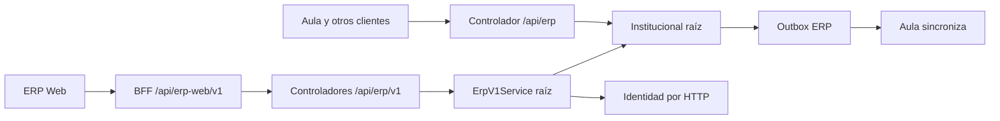
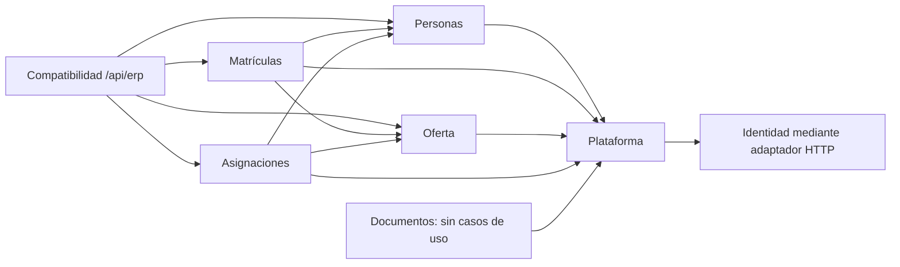

# ERP — plan de modularización incremental (diseño por aprobar)

## Alcance, estado y fuentes

**Fase 1, análisis solamente.** Este plan no autoriza mover código ni cambiar comportamiento, controladores, datos, migraciones o infraestructura. Los cinco módulos funcionales pedidos son Personas, Matrículas, Oferta académica, Asignaciones docentes y Documentos. La responsabilidad técnica compartida vive en `plataforma` o en adaptadores de compatibilidad; no se propone un sexto módulo funcional. El inventario método por método está en [MATRIZ_RESPONSABILIDADES.md](MATRIZ_RESPONSABILIDADES.md); las pruebas en [INVENTARIO_PRUEBAS_PENDIENTES.md](INVENTARIO_PRUEBAS_PENDIENTES.md).

**Fuentes verificables:** servicios heredados [`ErpV1Service`](../../apps/erp/api/src/main/java/pe/boston/erp/ErpV1Service.java) e [`Institucional`](../../apps/erp/api/src/main/java/pe/boston/erp/Institucional.java); controladores [`V1`](../../apps/erp/api/src/main/java/pe/boston/erp/PersonasController.java#L13) y [`legado`](../../apps/erp/api/src/main/java/pe/boston/erp/InstitucionalController.java#L13); requisitos [`REQUISITOS_Y_TRAZABILIDAD`](REQUISITOS_Y_TRAZABILIDAD.md#srs-y-casos-de-uso-confirmados); arquitectura actual [`ARQUITECTURA_Y_DATOS`](ARQUITECTURA_Y_DATOS.md#dependencias-actuales); contrato HTTP parcial [`CONTRATOS_API`](CONTRATOS_API.md) y [`openapi.yaml`](openapi.yaml). Los documentos de `docs/historico` son contexto, no autoridad para cambiar reglas activas. Las referencias de línea corresponden al árbol local de esta revisión.

## Diagnóstico

Los paquetes de los cinco módulos y varios controladores/fachadas existen, pero las escrituras principales, autorizaciones auxiliares y publicación aún están en dos servicios raíz. [`ArquitecturaModularTest:11-16`](../../apps/erp/api/src/test/java/pe/boston/erp/ArquitecturaModularTest.java#L11) verifica módulos reconocidos, no que cada módulo posea sus operaciones. [`BorradoresMatricula:20-24,60-97`](../../apps/erp/api/src/main/java/pe/boston/erp/matriculas/BorradoresMatricula.java#L20) e [`ImportacionMatriculas:38-40,203-233`](../../apps/erp/api/src/main/java/pe/boston/erp/matriculas/ImportacionMatriculas.java#L38) dependen directamente de V1. `Documentos` sólo tiene paquete y tabla; [`V4:54-59`](../../apps/erp/api/src/main/resources/db/migration/V4__erp_matriculas_v1.sql#L54). Tesorería heredada es explícitamente externa al alcance de los cinco módulos y debe conservarse; [`REQUISITOS:7`](REQUISITOS_Y_TRAZABILIDAD.md#vision-de-producto-prd).

### Diferencias de contrato que se deben congelar antes de extraer

| Asunto | V1 / ERP Web | `/api/erp` heredada | Consecuencia para extracción |
|---|---|---|---|
| Alta de alumno | [`V1:58-72`](../../apps/erp/api/src/main/java/pe/boston/erp/ErpV1Service.java#L58): documento par, único y código nulo | [`I:31-35`](../../apps/erp/api/src/main/java/pe/boston/erp/Institucional.java#L31): sólo nombre/apellido, parámetro `codigo` ignorado | Mantener DTO/validación/resultado por ruta; decidir después si se retira la entrada legacy. |
| Matrícula | [`V1:264-291,354-424`](../../apps/erp/api/src/main/java/pe/boston/erp/ErpV1Service.java#L264): inicia pendiente, reserva/cancela/confirma y pago externo | [`I:37-64`](../../apps/erp/api/src/main/java/pe/boston/erp/Institucional.java#L37): confirma de una vez, con sección y responsable identificado | No hacer que el adaptador legacy use V1 sin test de equivalencia; falta decisión sobre convergencia. |
| Sección y oferta | [`V1:495-560`](../../apps/erp/api/src/main/java/pe/boston/erp/ErpV1Service.java#L495): A-D, capacidad, relación activa, propaga ofertas a todas las secciones | [`I:181-189`](../../apps/erp/api/src/main/java/pe/boston/erp/Institucional.java#L181): nombre ≤30, inserción directa, sin sincronizar malla | Divergencia de política y permisos; caracterizar y no homogeneizar implícitamente. |
| Docente/asignación | [`V1:645-713`](../../apps/erp/api/src/main/java/pe/boston/erp/ErpV1Service.java#L645): Dirección, documento/cuenta/lote y conflicto seguro | [`I:87-94,190-195`](../../apps/erp/api/src/main/java/pe/boston/erp/Institucional.java#L87): Coordinación también, alta mínima, duplicado consultado antes de INSERT | Conservar roles y errores de cada ruta hasta aprobación explícita. |
| Responsables | [`V1:208-249`](../../apps/erp/api/src/main/java/pe/boston/erp/ErpV1Service.java#L208): documento compuesto, rol y contactos | [`I:196-214`](../../apps/erp/api/src/main/java/pe/boston/erp/Institucional.java#L196): persona con documento sin tipo, relación mínima | Preservar forma de respuesta y reglas legadas; no inferir compatibilidad semántica. |
| Lecturas/permisos | [`AccesoAcademico:9-20`](../../apps/erp/api/src/main/java/pe/boston/erp/plataforma/AccesoAcademico.java#L9): Dirección/Coordinación | [`I:19-28,133-180`](../../apps/erp/api/src/main/java/pe/boston/erp/Institucional.java#L19): Admin, scope `erp.read` o alumno propio según endpoint | Probar 401/403 por ruta. `estudiantesResumenCurso` no filtra `estado/vigente` explícitamente. |
| Contrato de respuestas | [`V1 controllers`](../../apps/erp/api/src/main/java/pe/boston/erp/matriculas/api/MatriculasController.java#L12): `Id`, `Map`, void | [`InstitucionalController:13-52`](../../apps/erp/api/src/main/java/pe/boston/erp/InstitucionalController.java#L13): formas `Map`, void y rutas distintas | Congelar JSON y códigos HTTP; `openapi.yaml` cubre sólo cinco caminos de BFF. |

### Autorización y transacciones

La cadena de [`Seguridad:65-71`](../../apps/erp/api/src/main/java/pe/boston/erp/plataforma/Seguridad.java#L65) exige JWT en `/api/erp/**` y scope `erp.sync` en `/api/erp/eventos`; las reglas de actor viven además en servicios o, en `ofertas`, en controlador. El BFF [`ErpWebProxy:58-103`](../../apps/erp/api/src/main/java/pe/boston/erp/plataforma/ErpWebProxy.java#L58) convierte cookie/OIDC+CSRF en bearer hacia V1. Al extraer, mantener validaciones de servicio, especialmente en llamadas desde borrador/importación y no sólo en controladores. La autorización por recurso/ámbito sigue parcialmente pendiente según [`ARQUITECTURA_Y_DATOS:68-69`](ARQUITECTURA_Y_DATOS.md#modelo-de-amenazas-y-controles-observados); no presentar el chequeo de rol como prueba de ausencia de IDOR.

Los mutadores de V1/I anotados con `@Transactional` incluyen SQL, historial, auditoría y outbox en la **misma transacción ERP**; conservar el punto de entrada externo de la transacción. Las llamadas internas `iniciarNuevo→crearEstudiante/iniciarMatricula`, `crearOferta→crearOfertaGrado`, `asignarDocenteLote→asignarDocente`, `estadoAcademico→retirar` y `reconciliar→publicarTodas` son **self-invocations**; no reciben un nuevo interceptor transaccional, pero participan en la transacción del método exterior. Evidencia: [`V1:257-264,548-560,703-707`](../../apps/erp/api/src/main/java/pe/boston/erp/ErpV1Service.java#L257), [`I:95-100,124-132`](../../apps/erp/api/src/main/java/pe/boston/erp/Institucional.java#L95). `Institucional.publicarSeccion/publicarOferta` no declaran TX y dependen del llamador; [`I:216-233`](../../apps/erp/api/src/main/java/pe/boston/erp/Institucional.java#L216). Todo adaptador futuro debe documentar si el llamado entra por proxy Spring y nunca separar commit ERP de outbox.

**Riesgo HTTP Identidad dentro de TX:** [`V1:661-669`](../../apps/erp/api/src/main/java/pe/boston/erp/ErpV1Service.java#L661) bloquea `docentes`, llama POST [`DirectorioIdentidad:27-42`](../../apps/erp/api/src/main/java/pe/boston/erp/plataforma/DirectorioIdentidad.java#L27) (timeout de solicitud 10 s) y sólo después actualiza ERP. Si Identidad crea la cuenta y ERP falla/rollback, queda cuenta remota sin vínculo local; si expira la respuesta después de éxito remoto, reintentar puede chocar por usuario duplicado. [`V1:671-686`](../../apps/erp/api/src/main/java/pe/boston/erp/ErpV1Service.java#L671) hace GET de verificación remota antes de UPDATE, con transacción abierta (GET de directorio: 5 s en [`DirectorioIdentidad:44-60`](../../apps/erp/api/src/main/java/pe/boston/erp/plataforma/DirectorioIdentidad.java#L44)). No existe transacción distribuida ni compensación observable. **Propuesta separada, no cambio en esta fase:** diseñar alta con operación idempotente `docenteId`/`usuario` y reconciliación de cuenta huérfana, y verificación previa o asíncrona con control de versión antes de actualizar. No mover la llamada fuera de TX sin definir semántica y pruebas de fallos.

## Dependencias y contratos públicos propuestos

Contratos **de diseño, no implementados ni aprobados como firmas definitivas**. Mantenerlos en el módulo propietario (API pública o interfaz expuesta) y llamar sólo en la dirección de la flecha. Usar UUID/DTOs inmutables y errores tipados equivalentes a los actuales; no exponer `JdbcTemplate` ni entidades SQL. La compatibilidad HTTP se queda en adaptadores, no en servicios funcionales.

| Puerto público propuesto / propietario | Cliente y operación mínima | Evidencia de necesidad / regla de acoplamiento |
|---|---|---|
| `PersonasConsulta` / P | M: `buscarAlumnoPorDocumento`, `fichaAlumno`, `responsablesIdentificados` | Borrador/confirmación consultan P: [`BorradoresMatricula:100-129`](../../apps/erp/api/src/main/java/pe/boston/erp/matriculas/BorradoresMatricula.java#L100), [`V1:388-395`](../../apps/erp/api/src/main/java/pe/boston/erp/ErpV1Service.java#L388). |
| `PersonasComando` / P | M: `crearFichaPreliminar`, `actualizarFicha`, `vincularResponsable`, `asignarCodigoSiFalta` | Transacción exterior M mantiene atomicidad y código al confirmar: [`V1:257-264,396-409`](../../apps/erp/api/src/main/java/pe/boston/erp/ErpV1Service.java#L257). |
| `OfertaConsulta` / O | M: `validarPeriodoGradoSeccion`; A: `validarOfertaActiva` | [`V1:264-286,330-338,688-693`](../../apps/erp/api/src/main/java/pe/boston/erp/ErpV1Service.java#L264). O no llama M/A. |
| `AsignacionesConsulta` / A | Adaptador legacy y proyección: `docenteActivo`, `docentesDeOferta`, `resumenDocentes` | [`I:134-139,218-225`](../../apps/erp/api/src/main/java/pe/boston/erp/Institucional.java#L134). |
| `MatriculasConsulta` / M | Adaptador legacy/proyección: `alumnosVigentesPorSeccion`, `resumenPorCurso` | [`I:140-150,218-225`](../../apps/erp/api/src/main/java/pe/boston/erp/Institucional.java#L140). |
| `PublicadorErp` / T | P/M/O/A: publicar cambio de oferta, ámbito y auditoría dentro de TX ERP; lector de eventos para Aula | [`I:107-132,216-236`](../../apps/erp/api/src/main/java/pe/boston/erp/Institucional.java#L107); conservar secuencia, versionado y snapshot. |
| `DirectorioDocente` / T (adaptador) | A: crear/verificar cuenta con Identidad | [`DirectorioIdentidad:27-60`](../../apps/erp/api/src/main/java/pe/boston/erp/plataforma/DirectorioIdentidad.java#L27); coordinación de fallo remoto pendiente. |

**Excepción de lectura transitoria a decidir:** `PublicadorErp` hoy construye un snapshot con SQL de O, M, A y P en [`I:218-225`](../../apps/erp/api/src/main/java/pe/boston/erp/Institucional.java#L218). Para evitar ciclos Java, la primera extracción puede dejar esa **consulta técnica de sólo lectura** en `plataforma`, con prueba de snapshot, y mantener en módulos dueños todas las escrituras. Una futura proyección materializada o ensamblador externo requeriría diseño y posiblemente migración, fuera de esta fase. No afirmar propiedad exclusiva de lectura SQL mientras exista esa excepción. Ningún módulo funcional debe depender de `Institucional` para publicar una vez extraído este puerto.

## Orden de extracción propuesto y tareas aprobables por separado

**Puerta previa común:** completar las caracterizaciones C01–C14 de [INVENTARIO_PRUEBAS_PENDIENTES.md](INVENTARIO_PRUEBAS_PENDIENTES.md) correspondientes a cada tarea antes de moverla. Para cada tarea: mismo endpoint/JSON/status/UUID/actor, SQL observable, estado, historial/audit/outbox, permisos y errores; `ApplicationModules.verify()` y ausencia de ciclos. La ubicación indicada es propuesta de archivos nuevos dentro de `apps/erp/api/src/main/java/pe/boston/erp/`; nombres exactos por aprobar en revisión técnica. No cambiar migraciones.

### 0. Congelar contratos y establecer caracterización

- **Origen → destino:** [`ErpV1Service`](../../apps/erp/api/src/main/java/pe/boston/erp/ErpV1Service.java), [`Institucional`](../../apps/erp/api/src/main/java/pe/boston/erp/Institucional.java), controladores y [`openapi.yaml`](openapi.yaml) → sólo pruebas bajo `apps/erp/api/src/test/` y documentación de contratos; ningún código productivo se mueve aún.
- **Responsabilidades/dependencias:** capturar dos superficies HTTP, BFF, Identidad y outbox con fixtures SQL. **Preservar:** toda diferencia V1/legacy de la tabla anterior.
- **Pruebas/aceptación:** C01–C14 relevantes, contract snapshots, roles y estado antes/después; salida = baseline reproducible y lista de divergencias conocida.
- **Riesgos/pendientes:** Testcontainers/Docker; datos temporales solamente; aprobación institucional de divergencias, IDOR, semántica de alumnos vigentes y política de pago/importación.

### 1. Extraer acceso, JSON, auditoría y outbox sin mover reglas de negocio

- **Origen → destino:** V1:28-50 e I:19-28,107-132,216-236 → `plataforma/AccesoAcademico` existente, `plataforma/AuditoriaErp`, `plataforma/PublicadorErp`, `plataforma/EventosErp`; fachada legacy para validaciones `admin/finanzas/lectura` cuando siga siendo necesaria.
- **Responsabilidades/dependencias:** autorización, serialización, audit, versiones, lock y eventos; T no importa P/M/O/A. **Preservar:** 1–200 eventos, secuencia/versiones, payload/orden, transacción del invocador, scope `erp.sync`, publicaciones de arranque [`DatosIniciales:9`](../../apps/erp/api/src/main/java/pe/boston/erp/DatosIniciales.java#L9).
- **Pruebas/aceptación:** C11,C12 y eventos de C06/C08/C09; rollback no deja outbox, commit conserva snapshot; servicios raíz siguen operativos a través de delegación y `ApplicationModules.verify()` pasa.
- **Riesgos/pendientes:** `publicarSeccion/publicarOferta` sin TX propia; consulta técnica transversal de snapshot y rol Admin legacy requieren decisión.

### 2. Extraer lectura y escritura de Personas

- **Origen → destino:** V1:58-249,404 e I:31,95,102,196-214 y rama estudiante de I:151-172 → `personas/PersonasService`, `personas/PersonasConsulta/Comando`, proyecciones del módulo; I conserva adaptador de ruta.
- **Responsabilidades/dependencias:** ficha preliminar, documento, historial visible, edad, persona/apoderado/vínculo, estado y código. P depende T; M llama P. **Preservar:** código sólo al confirmar; respuesta de búsqueda/verificación, idempotencia por documento, rol principal, `audit`, permisos diferenciados legacy/V1.
- **Pruebas/aceptación:** C01–C03, C06 código y C10 Personas; controladores V1 y borrador dejan de referenciar V1 para P, JSON y errores idénticos.
- **Riesgos/pendientes:** `estadoAcademico→retirar` toca matrículas; dividir comando orquestado en adaptador M sin ciclo; decisión sobre creación legacy con documento sin tipo y `codigo` ignorado.

### 3. Extraer reglas y consultas de Oferta académica

- **Origen → destino:** V1:438-453,456-632 e I:133,173,181-189 → `oferta/OfertaService`, `oferta/OfertaConsulta`, lector de catálogos; conservar `OfertaFacade` existente.
- **Responsabilidades/dependencias:** períodos, niveles, grados, secciones, malla, ofertas y sincronización. O depende T. **Preservar:** relación general/período, A-D en V1, propagación a todas las secciones, activación, IDs, publicación, campos de `/catalogos` y respuesta legacy.
- **Pruebas/aceptación:** C08,C10,C14 y outbox C11; `OfertaController` deja de inyectar V1; M/A consultan O vía puerto, sin ciclo.
- **Riesgos/pendientes:** permisos/validaciones distintos de legacy; `crearOferta` singular aplica a todas; decidir si la oferta legacy directa sigue soportada y por cuánto tiempo.

### 4. Extraer Matrículas por fases internas

- **Origen → destino:** V1:50,257-436 e I:37-86,140-150; `BorradoresMatricula` e `ImportacionMatriculas` ya viven en M → `matriculas/MatriculasService`, `matriculas/MatriculasConsulta`, `matriculas/HistorialMatricula`. Suborden: **4a** lectura/resumen, **4b** inicio y edición, **4c** reserva/cancelación/confirmación/pago, **4d** orquestación de borrador/importación, **4e** adaptador legacy matrícula/cambio/retiro.
- **Responsabilidades/dependencias:** M coordina P, O y T; conserva TX exterior de finalizar y confirmar. **Preservar:** borrador privado/único, procedencias, índice alumno/período, estados, código al confirmar, snapshot, pago externo, historial/audit/outbox, matrícula directa heredada.
- **Pruebas/aceptación:** C04–C07,C10,C13,C14 por subfase; `MatriculasController`, borrador e importación dejan de importar V1 para casos M; commit/rollback y concurrencia equivalentes.
- **Riesgos/pendientes:** importación masiva y idempotencia de borrador, criterio de `vigente` en resumen de Aula, diferencias legacy; política institucional para pagos/retiro.

### 5. Extraer docentes y asignaciones

- **Origen → destino:** V1:634-713 e I:87-94,134-139,190-195, rama docente I:151-172; [`DirectorioIdentidad`](../../apps/erp/api/src/main/java/pe/boston/erp/plataforma/DirectorioIdentidad.java) queda adaptador T → `asignaciones/AsignacionesService`, `asignaciones/AsignacionesConsulta`; conservar `AsignacionesFacade`.
- **Responsabilidades/dependencias:** alta/edición docente, vinculación a cuenta, lote y retiro; A consulta P/O y publica con T. **Preservar:** UUID/códigos, permiso Dir V1 vs Acad legacy, `ON CONFLICT` V1, límite lote 100, DTOs, outbox/audit.
- **Pruebas/aceptación:** C09,C10,C14 y C11; `AsignacionesController` deja de importar V1; fallo de Identidad caracterizado y sin cambio de semántica de TX en la mera extracción.
- **Riesgos/pendientes:** alta remota huérfana y GET remoto dentro de TX; aprobar un diseño de idempotencia/reconciliación aparte antes de cambiar secuencia de operaciones.

### 6. Cerrar adaptadores heredados y dependencias raíz

- **Origen → destino:** llamadas restantes de [`InstitucionalController:28-52`](../../apps/erp/api/src/main/java/pe/boston/erp/InstitucionalController.java#L28), [`ErpV1Controller:14-15`](../../apps/erp/api/src/main/java/pe/boston/erp/ErpV1Controller.java#L14), [`Tesoreria`](../../apps/erp/api/src/main/java/pe/boston/erp/Tesoreria.java) y `DatosIniciales` → adaptadores de compatibilidad del ERP y puertos P/M/O/A/T; ninguna ruta se elimina.
- **Responsabilidades/dependencias:** sólo traducir contratos y permisos legacy; no duplicar reglas nuevas. **Preservar:** todas las rutas `/api/erp` y `/api/erp/v1`, perfil/resúmenes y eventos para Aula, Tesorería sin cambios.
- **Pruebas/aceptación:** C10–C14 completos, ausencia de referencias raíz desde módulos/controladores, diffs de respuesta y side effects vacíos; `ApplicationModules.verify()` sin ciclos.
- **Riesgos/pendientes:** decidir eventual retiro de API legacy como proyecto separado; no se presupone aquí.

### 7. Documentos: sólo delimitación, no desarrollo nuevo

- **Origen → destino:** [`documentos/package-info`](../../apps/erp/api/src/main/java/pe/boston/erp/documentos/package-info.java) y metadatos [`V4:54-59`](../../apps/erp/api/src/main/resources/db/migration/V4__erp_matriculas_v1.sql#L54) → conservar `documentos/` como límite vacío de casos de uso.
- **Responsabilidades/dependencias:** ninguna operación de `ErpV1Service` o `Institucional` corresponde hoy a D. **Preservar:** tabla, constraints, ausencia de nuevas rutas o flujos.
- **Pruebas/aceptación:** C15; `ApplicationModules.verify()` y ningún cambio SQL; sólo después de requisitos aprobados se podrá diseñar API.
- **Riesgos/pendientes:** tipos, versión, obligatoriedad, visibilidad, retención, permisos y almacenamiento por validar institucionalmente; no inventarlos durante la refactorización.

## Decisiones y puertas de aprobación

| Estado | Decisión o constatación | Evidencia / efecto |
|---|---|---|
| **Aprobado por el alcance de esta solicitud** | Fase 1 documental; cinco módulos nombrados; sin refactor ni cambios en código/datos/migraciones/infra; sin commit/push | Instrucción de usuario; documentos de esta fase solamente. |
| **Confirmado por código, no aprobación institucional nueva** | Rutas V1/legacy, roles distintos, SQL, `@Transactional`, outbox, módulo Documentos sin API, Tesorería heredada | Matriz de métodos y fuentes anteriores. |
| **Propuesta para aprobar** | Puertos P/M/O/A/T, destinos de clases, suborden 0–7, adaptadores de compatibilidad, consulta de snapshot técnica temporal | Diagrama y tareas anteriores; revisar dependencias con Modulith antes de implementarlas. |
| **Requiere decisión institucional** | Convergencia de políticas legacy/V1, permisos por recurso y ámbitos, definición de alumno vigente en resúmenes, documentos, política de importación/pago/retiro, retiro futuro de API heredada | Divergencias de contrato y [`REQUISITOS_Y_TRAZABILIDAD:48-51`](REQUISITOS_Y_TRAZABILIDAD.md#decisiones-abiertas-y-limites). |
| **Requiere diseño técnico previo** | Idempotencia/compensación de Identidad; límites transaccionales de publicación; especificación OpenAPI completa y tipado de `Map` | [`V1:661-686`](../../apps/erp/api/src/main/java/pe/boston/erp/ErpV1Service.java#L661), [`I:216-233`](../../apps/erp/api/src/main/java/pe/boston/erp/Institucional.java#L216), [`CONTRATOS_API:3-5`](CONTRATOS_API.md#contratos-http-actuales). |

**Criterio para empezar la fase 2:** aprobar por escrito los puertos y la excepción de lectura técnica, resolver o aislar explícitamente las divergencias que afectan cada primera tarea, y tener la caracterización correspondiente ejecutándose contra PostgreSQL. Hasta entonces, este plan es una propuesta verificable, no una autorización de ejecución.
