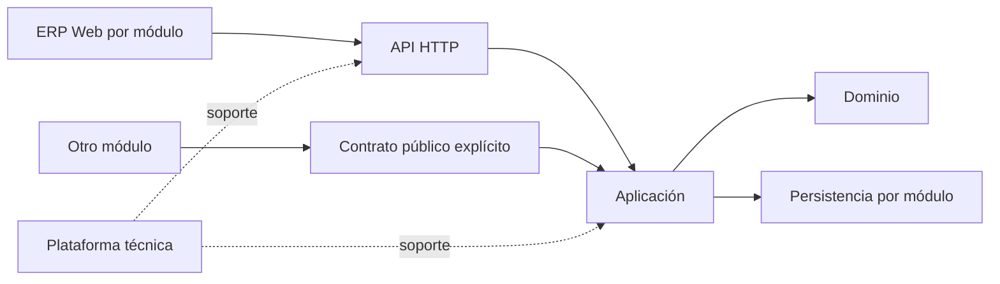

# Estándar de arquitectura modular del ERP

## Límite y propiedad

El ERP es un monolito Spring Boot/Spring Modulith con **exactamente cinco módulos funcionales**: `personas`, `matriculas`, `oferta`, `asignaciones`, `documentos`. `plataforma` contiene seguridad e infraestructura técnica común, sin reglas de negocio. El test [ArquitecturaModularTest](../../../apps/erp/api/src/test/java/pe/boston/erp/arquitectura/ArquitecturaModularTest.java) verifica el conjunto y los límites que Spring Modulith conoce; se complementará con reglas de capas.

| Ubicación | Responsabilidad | Prohibición principal |
|---|---|---|
| `api/` | Controladores, validación de transporte, DTO HTTP y mapeo de errores. | No contiene decisiones de negocio ni SQL. |
| `application/` | Casos de uso, transacciones, autorización por recurso y coordinación local. | No usa DTO propios de `api/`. |
| `domain/` | Invariantes y lenguaje del módulo. | No depende de HTTP, controladores, framework web ni persistencia. |
| `infrastructure/` | Repositorios y adaptadores técnicos. | No usa DTO de transporte HTTP ni exporta SQL a otro módulo. |
| `contratos/` o raíz pública | Interfaces y tipos estables entre módulos. | No expone implementaciones, repositorios ni DTO HTTP. |

Las flechas permitidas son `api → application → domain`; `application` accede a puertos o adaptadores de persistencia según la complejidad justificada. `infrastructure` implementa contratos internos y puede depender de `domain`/tipos propios de aplicación, nunca de `api`. Los modelos de aplicación son independientes del transporte. No se crean puertos, carpetas o clases por ritual: se justifican por una frontera o responsabilidad real. Una clase se divide si mezcla autorización, transacción, SQL y transporte o si su cambio habitual tiene varias causas; no por un umbral arbitrario de líneas.

## Dependencias entre módulos

Un consumidor importa solo una interfaz pública estable del proveedor. Si se publica `contratos/`, declárese `@NamedInterface` cuando corresponda y restrínjase `@ApplicationModule(allowedDependencies = "proveedor :: nombre")`; la raíz pública también es visible por defecto. No usar importaciones de paquetes internos ni ciclos. Una coordinación que necesite dos propietarios reside en el caso de uso que la inicia y usa contratos; si es entre servicios, se aplica [API e integraciones](ESTANDAR_API_INTEGRACIONES.md). Verificar con `ApplicationModules.verify()` y pruebas de arquitectura específicas de capas. [Spring Modulith documenta](https://docs.spring.io/spring-modulith/reference/fundamentals.html) las interfaces nombradas y las dependencias declaradas.

## Frontend

`apps/erp/web/src/modules/<modulo>/` concentra vistas, estado, validaciones y cliente del módulo. `shared/` acepta componentes técnicos reutilizables sin política de negocio; `app/` contiene rutas y composición. La autorización efectiva siempre es del backend. API, modelo, seguridad y UX específicos se describen en `ARQUITECTURA.md` del módulo.

## Estado real de Personas

Este estándar rige **a futuro y para refactorizaciones aprobadas**; no se declara satisfecho retrospectivamente. Hoy [PersonasServicio](../../../apps/erp/api/src/main/java/pe/boston/erp/personas/application/PersonasServicio.java), [AutorizacionPersonas](../../../apps/erp/api/src/main/java/pe/boston/erp/personas/application/AutorizacionPersonas.java) y [PersonasRepositorio](../../../apps/erp/api/src/main/java/pe/boston/erp/personas/infrastructure/PersonasRepositorio.java) importan tipos de [PersonaDto](../../../apps/erp/api/src/main/java/pe/boston/erp/personas/api/PersonaDto.java). El contrato público [PersonasParaMatriculas](../../../apps/erp/api/src/main/java/pe/boston/erp/personas/PersonasParaMatriculas.java) existe en la raíz, no en `contratos/`. Separar modelos internos/DTO y decidir `contratos/`/`@NamedInterface` sigue pendiente de refactorización; no es un fallo de las pruebas actuales de límites entre módulos.
