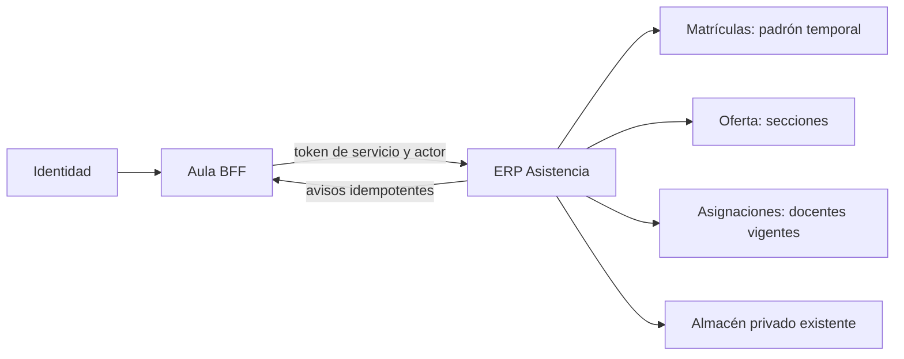

# Asistencia — arquitectura

ERP es dueño de hechos y estados. [Matrículas](../../../../apps/erp/api/src/main/java/pe/boston/erp/matriculas/MatriculasParaAsistencia.java), [Oferta](../../../../apps/erp/api/src/main/java/pe/boston/erp/oferta/OfertaConsulta.java) y [Asignaciones](../../../../apps/erp/api/src/main/java/pe/boston/erp/asignaciones/AsignacionesParaAsistencia.java) exponen contratos de consulta sin dependencia circular. El BFF de Aula usa una sesión humana validada y un token de servicio con audiencia y scope específicos; el ERP valida ambos en su ruta interna. Las acciones ERP humanas usan la sesión OIDC existente.

El avance se guarda en `ast_borradores`, separado de `ast_registros`. Cada jornada usa versión y clave de operación. El cierre y las excepciones usan transacciones ERP; la entrega de avisos se confirma de forma independiente, con reintentos.
