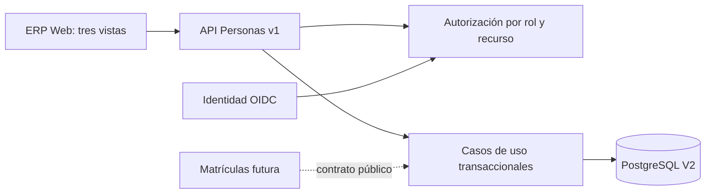

# Arquitectura — Personas

## Componentes y límites

Personas será el registro central de personas físicas. Una persona podrá tener múltiples condiciones y relaciones institucionales sin duplicar sus datos personales.

Las entidades conceptuales aprobadas son Persona, Documento de identidad, Condición institucional y Vínculo entre personas. Su materialización PostgreSQL V2 es una propuesta técnica implementada, pendiente de aprobación arquitectónica definitiva.

La persona conserva su UUID al corregir su identidad. Las condiciones institucionales son independientes de los roles de seguridad, conforme a las [políticas transversales](../../POLITICAS_TRANSVERSALES.md). El vínculo con un estudiante es distinto de la condición Apoderado y del parentesco.

El módulo usa `api/`, `application/`, `domain/` e `infrastructure/` en Java y `modules/personas/` en React. Personas no es propietario de credenciales, matrículas, oferta académica ni asignaciones docentes. Spring Modulith verifica sus límites en la suite.

**Brecha vigente:** `application/` e `infrastructure/` importan `api.PersonaDto`; la separación de modelos internos y el posible paquete `contratos/` con `@NamedInterface` están pendientes de refactorización. El test actual de Spring Modulith verifica módulos, no esta regla entre capas. Ver [estándar modular](../../ingenieria/ESTANDAR_ARQUITECTURA_MODULAR.md).

## Contratos, seguridad e interfaz

Todos los endpoints nuevos están bajo `/api/erp/v1/personas`; reciben/devolven JSON salvo las mutaciones que devuelven `Location` o 204. El contrato tipado se expone a Dirección/Administración en `/api/erp/v1/openapi` mediante springdoc. Los DTO están en `PersonaDto.java`; el esquema de error controlado es `{codigo,mensaje}`: 400 datos/formato, 401 sin sesión, 403 sin facultad, 404 recurso inexistente, 409 conflicto de unicidad o vigencia.

| Método y ruta relativa a `/api/erp/v1/personas` | Contrato principal | Facultad |
|---|---|---|
| `GET /capacidades` | `Capacidades` de la sesión | ERP autenticado permitido. |
| `GET /tipos-documento`, `POST /tipos-documento` | Lista y alta de `TipoDocumento` | Gestión; alta reservada a Dirección/Administración. |
| `GET /duplicado-documental?tipo=&pais=&numero=` | `{existe:boolean}`, sin identidad revelada | Registro. |
| `GET /?buscar=&condicion=&vigente=&pagina=&tamano=` | `Pagina<Resumen>`, tamaño 1–50 | Gestión con ámbito. |
| `POST /` | `CrearPersona`; 201 con `Location` | Dirección/Administración o Coordinación para alta; apoderado inicial requiere gestión con ámbito. |
| `GET /{id}` | `Persona` con documentos, condiciones, provisional y vínculos | Recurso autorizado. |
| `PUT /{id}`, `PUT /{id}/contacto` | `EditarPersona`, `Contacto` | Identidad reservada; contacto según ámbito o propio docente. |
| `POST /{id}/documentos` | `DocumentoEntrada` | Identidad reservada. |
| `POST /{id}/condiciones`, `POST /{id}/condiciones/{condicion}/desactivar` | `NuevaCondicion`, `Motivo` | Gestión con ámbito. |
| `POST /parentescos`, `POST /{id}/parentescos/{vinculo}/desactivar` | `ParentescoEntrada`, cierre | Gestión con ámbito. |
| `POST /apoderamientos`, `POST /{id}/apoderamientos/{vinculo}/desactivar` | `ApoderamientoEntrada` con autorización cuando aplique; cierre | Gestión con ámbito. |

La comprobación de autorización no familiar admite sustento verbal u otro tipo registrado sin imponer un catálogo institucional no aprobado. Si no se indica el tipo, el flujo actual usa `VERBAL` como valor predeterminado técnico. En todos los casos registra autorizador, verificador (sub de sesión), medio, instante y referencia. La facultad del autorizador se comprueba por el personal actuante; la forma exacta del sustento y sus pruebas institucionales permanecen pendientes.

La fachada `PersonasParaMatriculas` en la raíz del módulo ofrece búsqueda por documento, alta de estudiante, comprobación de condición e identificación, apoderados vigentes y vinculación autorizada. Matrículas aún no consume la interfaz y Personas no accede a tablas de Matrículas. Las operaciones podrán participar en transacciones locales del ERP; no hacen HTTP a Identidad dentro de una transacción.

Administración y Dirección gestionan la ficha; Coordinación registra y necesita una afirmación verificable de ámbito para consultar o modificar recursos existentes. El código reconoce el claim `personas_ambito=INSTITUCIONAL` solo como contrato preparatorio: Identidad todavía no lo emite, por lo que esas operaciones se deniegan hoy. Docente solo consulta/edita contacto propio si `referencia_erp` coincide con el UUID. El acceso docente a alumnos asignados permanece denegado hasta que Asignaciones provea una relación verificable. Estudiantes y apoderados no tienen acceso ERP. `SeguridadWeb` mantiene denegación por defecto y CSRF en escrituras.

El frontend contiene Directorio, Registro contextual y Ficha; usa búsqueda paginada, verificación de duplicado, campos por condición, identificación provisional, selector de personas para vínculos, estados de carga/vacío/error/éxito y acciones según capacidades. Está en `apps/erp/web/src/modules/personas/`. La cobertura y las verificaciones pendientes se documentan en [PRUEBAS.md](PRUEBAS.md).

## Decisiones técnicas pendientes

Revisar separación de DTO HTTP, contrato público y dependencias declaradas; diseñar permisos expresos de Identidad/Asignaciones antes de habilitar accesos. La nueva política funcional de [ESPECIFICACION.md](ESPECIFICACION.md) exige diferenciar contacto autorizado, apoderado con alcance limitado y representante legal, con historial de modificación/revocación; el contrato y el modelo actuales no bastan automáticamente. La corrección excepcional de asociación documental histórica, los estados de información pendiente y los catálogos requieren diseño propio. El registro de Coordinación basado solo en rol y la corrección de identidad sin facultad específica son brechas de seguridad que deben resolverse antes de habilitar esas operaciones; esta descripción no modifica permisos efectivos.
