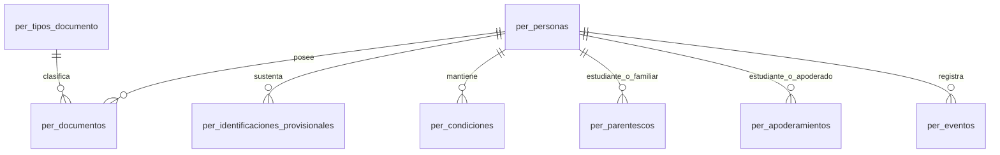
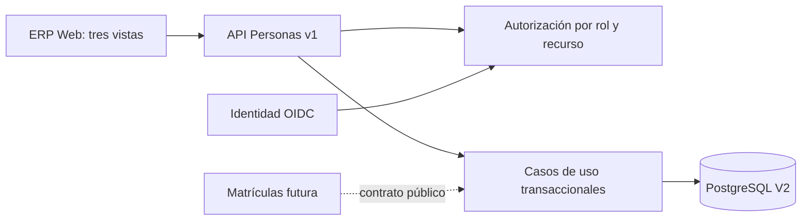

# Especificación — Personas

## 1. Requisitos funcionales

Los nueve objetivos funcionales están aprobados. La implementación actual y sus límites se describen en las secciones siguientes; los aspectos institucionales no resueltos permanecen explícitos en la sección 8. Ninguna regla se hereda automáticamente del ERP anterior.

| Código | Objetivo aprobado |
|---|---|
| RF-PER-001 | Registrar una persona con datos identificativos. |
| RF-PER-002 | Buscar personas por nombre o documento. |
| RF-PER-003 | Detectar posibles duplicados antes del registro. |
| RF-PER-004 | Consultar y actualizar información personal. |
| RF-PER-005 | Asignar múltiples condiciones institucionales a una persona. |
| RF-PER-006 | Registrar relaciones entre estudiantes, familiares y responsables. |
| RF-PER-007 | Consultar una ficha personal con condiciones y relaciones. |
| RF-PER-008 | Activar y desactivar condiciones institucionales conservando el historial. |
| RF-PER-009 | Registrar automáticamente la trazabilidad técnica de modificaciones relevantes, sin exigir aprobaciones manuales ni una pantalla de auditoría. |

## 2. Requisitos no funcionales

Se aplican también las [políticas transversales](../../POLITICAS_TRANSVERSALES.md). Los criterios siguientes son verificables; una prueba aislada no cierra por sí sola el objetivo completo.

| Código | Objetivo y criterio verificable | Evidencia actual |
|---|---|---|
| RNF-PER-001 | Cada operación comprueba rol y recurso; sin sesión responde 401 y sin facultad 403; CSRF protege escrituras. | `PersonasHttpTest`, `AutorizacionPersonas`, `SeguridadWeb`. Falta contrato comprobable de ámbito para Coordinación y alumnado asignado a Docentes. |
| RNF-PER-002 | Ningún commit puede dejar persona sin condición/identificación, documentos vigentes duplicados, principal simultáneo o vigencias superpuestas; la concurrencia no lo elude. | `PersonasEsquemaTest` con PostgreSQL 18.6 real. |
| RNF-PER-003 | Crear, corregir, activar y desactivar escribe actor, acción, recurso y fecha sin copiar valores personales; la operación y evento comparten transacción. | `per_eventos`, `PersonasServicio`; falta prueba específica de cada evento. |
| RNF-PER-004 | Con 30 000 personas y 30 usuarios concurrentes, búsquedas p95 ≤ 2 s y guardados habituales p95 ≤ 3 s. | `PersonasRendimientoTest`: última suite, 300 búsquedas p95 183 ms y 30 guardados p95 218 ms en Docker Desktop; medición JDBC, no extremo a extremo. |
| RNF-PER-005 | El API solo devuelve datos para recursos autorizados; ninguna contraseña ni valor anterior de identidad se guarda en auditoría; la retención y protección operativa requieren política institucional. | Pruebas HTTP de permisos y revisión de `per_eventos`; pendiente revisión de retención y controles operativos. |
| RNF-PER-006 | Objetivo WCAG 2.2 AA: campos etiquetados, foco y teclado utilizables, estados de carga/error/éxito anunciados y contraste verificable. | Build TypeScript y cuatro pruebas React, incluida revisión axe de etiquetas y ARIA; auditoría WCAG completa/manual pendiente. |

## 3. Reglas institucionales

Estas reglas están aprobadas a nivel institucional. Los formatos y validaciones concretas no acordados permanecen pendientes; el estado de implementación se detalla más abajo.

| Código | Regla aprobada |
|---|---|
| RI-PER-001 | Cada persona tendrá un único registro personal institucional. |
| RI-PER-002 | Una persona podrá tener múltiples condiciones institucionales simultáneamente. |
| RI-PER-003 | Cada condición institucional tendrá un estado independiente. |
| RI-PER-004 | Desactivar una condición no desactivará las demás condiciones y relaciones que continúen siendo válidas. |
| RI-PER-005 | La desactivación no eliminará datos ni historiales personales. |
| RI-PER-006 | La obligatoriedad de datos dependerá de las condiciones institucionales de la persona. |
| RI-PER-007 | Toda persona deberá registrarse con documento de identidad. |
| RI-PER-008 | Para estudiantes, teléfono y correo electrónico serán opcionales. Los demás datos de la matriz acordada serán obligatorios, sujetos a la posterior definición de validaciones. |
| RI-PER-009 | Para apoderados, el correo electrónico será opcional y los demás datos definidos serán obligatorios. |
| RI-PER-010 | Para docentes y personal institucional, todos los datos definidos en la matriz serán obligatorios. |
| RI-PER-011 | Si una persona adquiere otra condición institucional, deberá completar los datos adicionales necesarios sin crear otro registro personal. |
| RI-PER-012 | Los tipos de documento inicialmente admitidos serán DNI, carné de extranjería y pasaporte. El catálogo podrá ampliarse mediante configuración administrativa. |
| RI-PER-013 | No podrán existir dos personas con el mismo tipo y número de documento vigente, después de una normalización apropiada. La normalización y las validaciones de formato concretas quedan pendientes de definición. |
| RI-PER-014 | Si el documento ya está registrado, se permitirá consultar la ficha existente según los permisos aplicables y se incorporará cualquier nueva condición a esa persona, sin crear otro registro. |
| RI-PER-015 | La similitud de nombres nunca provocará una fusión automática de personas. |
| RI-PER-016 | Dirección y Administración podrán corregir documentos y datos de identidad dentro de sus facultades autorizadas, sin aprobaciones adicionales y conservando el UUID de la persona. |
| RI-PER-017 | Las condiciones institucionales iniciales serán Estudiante, Docente, Personal institucional y Apoderado. |
| RI-PER-018 | Cada condición tendrá estado Activa o Inactiva, vigencia y motivo de desactivación cuando corresponda. Sus estados y vigencias serán independientes y podrán coexistir varias condiciones por persona. |
| RI-PER-019 | Apoderado será una condición institucional de la persona y requerirá vínculos explícitos con los estudiantes correspondientes. |
| RI-PER-020 | Un estudiante podrá tener varios apoderados simultáneamente, sin categorías de apoderado principal o secundario. |
| RI-PER-021 | La condición de Apoderado es independiente del parentesco; este no otorgará automáticamente facultades legales. |
| RI-PER-022 | Los vínculos entre personas conservarán su historial y vigencia. |
| RI-PER-023 | La autorización o el control operativo de recojo de estudiantes no forman parte de Personas. |
| RI-PER-024 | Coordinación Académica podrá registrar, consultar y editar información de Personas dentro de su ámbito autorizado. El detalle de acciones y ámbitos queda pendiente. |
| RI-PER-025 | El personal autorizado podrá actualizar inmediatamente teléfono, correo y demás datos de contacto cotidianos, sin solicitudes de aprobación. Las correcciones sensibles quedarán reservadas a los perfiles autorizados. |
| RI-PER-026 | Las operaciones sensibles tendrán trazabilidad técnica automática y proporcional, sin conservar innecesariamente valores personales ni requerir una pantalla de auditoría. |
| RI-PER-027 | Una persona podrá ser apoderada de varios estudiantes. Si no tiene parentesco familiar con alguno, el vínculo requerirá autorización institucional válida. El vínculo de apoderado no acreditará por sí solo representación legal para todos los trámites. |
| RI-PER-028 | Cada vínculo estudiante–apoderado tendrá estado Activo o Inactivo y vigencia propia, sin afectar los demás vínculos. |
| RI-PER-029 | La condición institucional Apoderado permanecerá Activa mientras exista al menos un vínculo de apoderado vigente y Activo. Si no existe ninguno, quedará Inactiva y conservará su historial, sin afectar las demás condiciones institucionales de la persona. |
| RI-PER-030 | Coordinación Académica, Dirección y Administración podrán registrar vínculos de apoderados dentro de sus facultades autorizadas. Para una persona sin parentesco familiar, comprobarán la autorización institucional correspondiente y registrarán el vínculo en la misma operación administrativa, sin aprobación adicional. |
| RI-PER-031 | Cuando corresponda comprobar una autorización, el ERP conservará como mínimo quién la verificó, la fecha de verificación, el tipo o referencia del sustento y el vínculo estudiante–apoderado correspondiente, sin almacenar datos adicionales innecesarios. |
| RI-PER-032 | Finalizar o desactivar un vínculo estudiante–apoderado no afectará los demás vínculos vigentes de la persona. |
| RI-PER-033 | El apoderado será reconocido para contacto y gestiones institucionales ordinarias. El módulo responsable de una operación que requiera representación legal deberá comprobar esa facultad de forma independiente; la condición Apoderado no la concede automáticamente para todos los trámites. |
| RI-PER-034 | Se admite autorización verbal para vincular como apoderado a una persona sin parentesco familiar. Coordinación Académica, Dirección o Administración la comprobará directamente con una persona facultada para otorgarla, presencialmente, por teléfono u otro medio verificable. Se registrará quién autorizó, el medio, la fecha y hora, el personal que comprobó la autorización y el vínculo estudiante–apoderado. |
| RI-PER-035 | Toda persona nueva se registra en una operación atómica con al menos una condición institucional válida; un apoderado como única condición inicial requiere un vínculo válido en la misma operación. |
| RI-PER-036 | Un estudiante sin documento oficial puede identificarse provisionalmente con motivo, tipo y referencia del sustento y regularización pendiente; no se inventa un DNI. La posterior regularización conserva el UUID y el historial. Esta excepción no se extiende automáticamente a docentes o personal. |
| RI-PER-037 | Matriz de acceso aprobada: Administración y Dirección gestionan Personas dentro de sus facultades; Coordinación registra, consulta y edita en su ámbito autorizado sin corregir identidad reservada; Docentes solo acceden a información necesaria de estudiantes asignados y, cuando corresponda, a su propio contacto; Estudiantes y Apoderados no acceden directamente al ERP. La condición institucional no concede un rol de seguridad. |

### Datos personales y obligatoriedad por condición

| Dato | Estudiante | Apoderado | Docente | Personal institucional |
|---|---|---|---|---|
| UUID interno | Generado automáticamente | Generado automáticamente | Generado automáticamente | Generado automáticamente |
| Nombres | Obligatorio | Obligatorio | Obligatorio | Obligatorio |
| Apellidos | Obligatorio | Obligatorio | Obligatorio | Obligatorio |
| Tipo y número de documento | Obligatorio, salvo identificación provisional sustentada | Obligatorio | Obligatorio | Obligatorio |
| Fecha de nacimiento | Obligatorio | Obligatorio | Obligatorio | Obligatorio |
| Sexo | Obligatorio | Obligatorio | Obligatorio | Obligatorio |
| Nacionalidad | Obligatorio | Obligatorio | Obligatorio | Obligatorio |
| Teléfono | Opcional | Obligatorio | Obligatorio | Obligatorio |
| Correo electrónico | Opcional | Opcional | Obligatorio | Obligatorio |
| Dirección domiciliaria | Obligatorio | Obligatorio | Obligatorio | Obligatorio |

El UUID lo genera el servidor. Si se añade otra condición a una persona existente, se completan los datos exigidos por esa condición en el mismo registro (RI-PER-011 y RI-PER-014). La única excepción documental actual es RI-PER-036. La norma técnica de matrícula 2026 del MINEDU admite sustento provisional y regularización posterior; Personas conserva la identificación, mientras Matrículas decide el trámite. El único formato cerrado en esta versión es el DNI peruano de ocho dígitos; los formatos CE y pasaporte siguen configurables.

## 4. Actores y casos de uso

Coordinación Académica actúa dentro de un ámbito comprobable; Dirección y Administración pueden corregir identidad. La auditoría de RF-PER-009 es automática y no crea un octavo caso de uso.

| Código | Caso de uso aprobado |
|---|---|
| CU-PER-01 | Registrar persona. |
| CU-PER-02 | Buscar persona. |
| CU-PER-03 | Editar persona. |
| CU-PER-04 | Incorporar condición institucional. |
| CU-PER-05 | Vincular familiar o responsable. |
| CU-PER-06 | Consultar ficha personal. |
| CU-PER-07 | Desactivar o reactivar condición institucional. |

### Flujos y criterios de aceptación

| Caso | Flujo principal y alternativos | Error y criterio verificable |
|---|---|---|
| CU-PER-01 | Elegir condición, completar datos y documento; alternativamente, estudiante con sustento provisional. Apoderado inicial exige vínculo en el mismo commit. | Falta de condición, identificación o contacto exigido: 400/409 y rollback. Documento vigente repetido: 409, sin nueva persona. UUID creado solo al finalizar la transacción. |
| CU-PER-02 | Buscar por nombre, apellido o documento, filtrar condición y vigencia, paginar. | Sin ámbito: 403. No coincidentes: lista vacía. La similitud no fusiona ni altera registros. |
| CU-PER-03 | Corregir datos comunes o contacto; documento nuevo cierra principal anterior, regulariza provisional y conserva UUID. | Solo Dirección/Administración corrige identidad; Docente propio y Coordinación con ámbito pueden editar contacto. Un documento repetido da 409 y conserva el anterior. |
| CU-PER-04 | Añadir condición a persona existente y comprobar datos adicionales; APODERADO se deriva de vínculos. | Condición ya activa: 409. Contacto insuficiente: 400. Histórico anterior permanece al reactivar. |
| CU-PER-05 | Registrar parentesco o apoderamiento; para no familiar, comprobar autorización verbal y guardar autorizador, medio, fecha, verificador y referencia. | Duplicado vigente: 409. Falta de autorización: 400. Se pueden mantener varios apoderados, y cerrar uno no afecta otros. |
| CU-PER-06 | Abrir ficha con identidad, documentos, condiciones, parentescos y apoderamientos históricos. | Sin permiso sobre recurso: 403; UUID inexistente: 404. No se muestra historial de valores personales en eventos. |
| CU-PER-07 | Desactivar condición con motivo o reactivar creando un nuevo período; apoderamiento se cierra de forma independiente. | Períodos no se superponen; cierre con apoderamiento incompatible se rechaza y hace rollback. |

## 5. Criterios de aceptación

Los criterios de cada CU figuran arriba. La integración de Coordinación y el acceso docente a alumnos asignados siguen abiertos porque Identidad/Asignaciones aún no suministran un ámbito comprobable. La interfaz y la auditoría de accesibilidad requieren verificación adicional; por ello no se declara cerrado el módulo.

## 6. Arquitectura y modelo de datos

Personas será el registro central de personas físicas. Una persona podrá tener múltiples condiciones y relaciones institucionales sin duplicar sus datos personales.

Las entidades conceptuales aprobadas son Persona, Documento de identidad, Condición institucional y Vínculo entre personas. Su materialización PostgreSQL V2 es una propuesta técnica implementada, pendiente de aprobación arquitectónica definitiva.

La persona conserva su UUID al corregir su identidad. Las condiciones institucionales son independientes de los roles de seguridad, conforme a las [políticas transversales](../../POLITICAS_TRANSVERSALES.md). El vínculo con un estudiante es distinto de la condición Apoderado y del parentesco.

El módulo usa `api/`, `application/`, `domain/` e `infrastructure/` en Java y `modules/personas/` en React. Personas no es propietario de credenciales, matrículas, oferta académica ni asignaciones docentes. Spring Modulith verifica sus límites en la suite.

### Modelo físico V2 (implementación técnica, no nueva política institucional)

La migración `V2__personas.sql` usa `erp_boston_nuevo` en desarrollo; V1 permanece intacta. La unidad de identidad es `per_personas.id` (UUID estable). Los intervalos son rangos `[inicio, fin)`; PostgreSQL 18 aplica `UNIQUE (..., periodo WITHOUT OVERLAPS)` para impedir superposiciones. `btree_gist` habilita las claves escalares del rango y `pg_trgm` la búsqueda por nombre.

| Relación física | Responsabilidad y claves | Integridad principal |
|---|---|---|
| `per_personas` | Datos comunes; `id` UUID | Nombres, apellidos, nacimiento, sexo, nacionalidad y dirección requeridos; no se expone borrado ordinario. |
| `per_tipos_documento` | Catálogo extensible; `codigo` | DNI, CE y PASAPORTE iniciales; patrón de DNI peruano de ocho dígitos. |
| `per_documentos` | Documentos históricos de una persona; `id` UUID | Tipo, país, número normalizado y período no solapados; un principal por persona en cualquier instante. |
| `per_identificaciones_provisionales` | Sustento de estudiante sin documento; `id` UUID | Solo una identificación provisional pendiente por persona; regularización sin reemplazar UUID. |
| `per_condiciones` | Períodos históricos de Estudiante, Docente y Personal institucional; `id` UUID | Períodos no solapados por persona y tipo; cierre manual con motivo. Apoderado se deriva de sus vínculos activos. |
| `per_parentescos` | Relación familiar dirigida entre estudiante y familiar; `id` UUID | Historial sin superposición de un mismo tipo de parentesco. No otorga representación legal. |
| `per_apoderamientos` | Vínculo individual estudiante–apoderado; `id` UUID | Períodos no solapados por pareja; constancia de autorización cuando no existe parentesco. |
| `per_eventos` | Trazabilidad técnica mínima; `id` UUID | Actor, acción, recurso y momento, sin copias de valores personales. |

La condición visible Apoderado se calcula a partir de los apoderamientos vigentes y activos; no se guarda un segundo estado físico. La creación de una persona y de su primera condición o vínculo ocurre en una transacción. La comprobación diferida de existencia de una condición y de documento o identificación provisional es una necesidad de integridad entre tablas que un `CHECK` local no puede satisfacer. Las operaciones concurrentes deben apoyarse además en las restricciones temporales y bloqueos de las personas involucradas.

### Diccionario de datos y relaciones

| Tabla | Columnas (además de claves foráneas indicadas) | Relación y significado |
|---|---|---|
| `per_personas` | `id` UUID PK; `nombres`, `apellidos`, `fecha_nacimiento`, `sexo`, `nacionalidad`, `telefono`, `correo`, `direccion`, `creado_en`, `actualizado_en` | Fuente única de datos personales. |
| `per_tipos_documento` | `codigo` PK, `nombre`, `patron`, `activo` | Catálogo administrable; DNI, CE y PASAPORTE iniciales. |
| `per_documentos` | `id` PK; `persona_id` FK, `tipo_codigo` FK, `pais_emisor`, `numero`, `numero_normalizado`, `principal`, `vigente_desde`, `vigente_hasta`, `periodo` generado | Historial documental. Número normalizado equivale a recorte de espacios externos. |
| `per_identificaciones_provisionales` | `id` PK; `persona_id` FK, `motivo`, `sustento_tipo`, `sustento_referencia`, `registrada_en`, `regularizada_en` | Excepción de estudiante pendiente de regularización. |
| `per_condiciones` | `id` PK; `persona_id` FK, `tipo`, `vigente_desde`, `vigente_hasta`, `cierre_manual`, `motivo_desactivacion`, `periodo` generado | Estudiante, Docente y Personal institucional; Apoderado derivado. |
| `per_parentescos` | `id` PK; `estudiante_id` y `familiar_id` FK, `tipo`, `vigente_desde`, `vigente_hasta`, `periodo` generado | Parentesco dirigido, distinto de apoderamiento. |
| `per_apoderamientos` | `id` PK; `estudiante_id` y `apoderado_id` FK, `sin_parentesco`, `autorizador`, `verificador_sub`, `medio_verificacion`, `verificado_en`, `sustento_tipo`, `sustento_referencia`, `vigente_desde`, `vigente_hasta`, `motivo_desactivacion`, `periodo` generado | Relación individual e historial. |
| `per_eventos` | `id` PK; `persona_id` FK, `recurso_id`, `accion`, `actor_sub`, `ocurrido_en` | Auditoría de metadatos, sin valores personales anteriores. |

### Restricciones e índices aplicados

| Invariante/consulta | Mecanismo SQL |
|---|---|
| Documento único por tipo, país, número e intervalo | `per_documento_unico_vigencia` con `WITHOUT OVERLAPS`; índice parcial `per_documentos_busqueda_idx` para documento abierto. |
| Un principal simultáneo por persona | Exclusión GiST `per_documento_principal_vigencia` e índice único parcial `per_documentos_principal_abierto_idx`. |
| Vigencias independientes no solapadas | `per_condicion_sin_solape`, `per_parentesco_sin_solape`, `per_apoderamiento_sin_solape`. |
| Persona con condición e identificación; apoderamiento respaldado; contacto exigido | Triggers diferidos de integridad al cierre de transacción; no se simula `CHECK` entre tablas. |
| Provisional única pendiente | `per_provisional_pendiente_idx`. |
| Búsqueda por nombre y relaciones | `per_personas_nombre_trgm_idx`, índices de condiciones vigentes, parentescos por familiar y apoderamientos en ambos sentidos. |

No hay particionamiento ni caché adicional. La prueba de carga registró un `Seq Scan` para la búsqueda de nombre concreto (23,3 ms con 30 000 filas) y un `Index Scan` para documento exacto (0,18 ms); son resultados del entorno local, no una garantía de producción.

La normalización propuesta conserva caracteres internos y elimina solo espacios exteriores; para DNI peruano se comprueban exactamente ocho dígitos. No se eliminan caracteres de documentos extranjeros. Los criterios de formato de otros documentos siguen pendientes. La identificación provisional se fundamenta en la [norma técnica de matrícula 2026 del MINEDU](https://repositorio.minedu.gob.pe/handle/20.500.12799/11849), que contempla declaración jurada y regularización posterior; Personas registra la situación, mientras Matrículas conserva su propio trámite.

## 7. Contratos, seguridad e interfaz

Todos los endpoints nuevos están bajo `/api/erp/v1/personas`; reciben/devolven JSON salvo las mutaciones que devuelven `Location` o 204. El contrato tipado se expone a Dirección/Administración en `/api/erp/v1/openapi` mediante springdoc. Los DTO están en `PersonaDto.java`; el esquema de error controlado es `{codigo,mensaje}`: 400 datos/formato, 401 sin sesión, 403 sin facultad, 404 recurso inexistente, 409 conflicto de unicidad o vigencia.

| Método y ruta relativa a `/api/erp/v1/personas` | Contrato principal | Facultad |
|---|---|---|
| `GET /capacidades` | `Capacidades` de la sesión | ERP autenticado permitido. |
| `GET /tipos-documento`, `POST /tipos-documento` | Lista y alta de `TipoDocumento` | Gestión; alta reservada a Dirección/Administración. |
| `GET /duplicado-documental?tipo=&pais=&numero=` | `{existe:boolean}`, sin identidad revelada | Registro. |
| `GET /?buscar=&condicion=&vigente=&pagina=&tamano=` | `Pagina<Resumen>`, tamaño 1–50 | Gestión con ámbito. |
| `POST /` | `CrearPersona`; 201 con `Location` | Dirección/Administración o Coordinación para alta; apoderado inicial requiere gestión con ámbito. |
| `GET /{id}` | `Persona` con documentos, condiciones, provisional y vínculos | Recurso autorizado. |
| `PUT /{id}`, `PUT /{id}/contacto` | `EditarPersona`, `Contacto` | Identidad reservada; contacto según ámbito o propio docente. |
| `POST /{id}/documentos` | `DocumentoEntrada` | Identidad reservada. |
| `POST /{id}/condiciones`, `POST /{id}/condiciones/{condicion}/desactivar` | `NuevaCondicion`, `Motivo` | Gestión con ámbito. |
| `POST /parentescos`, `POST /{id}/parentescos/{vinculo}/desactivar` | `ParentescoEntrada`, cierre | Gestión con ámbito. |
| `POST /apoderamientos`, `POST /{id}/apoderamientos/{vinculo}/desactivar` | `ApoderamientoEntrada` con autorización cuando aplique; cierre | Gestión con ámbito. |

La comprobación de autorización no familiar admite sustento verbal u otro tipo registrado sin imponer un catálogo institucional no aprobado. Si no se indica el tipo, el flujo actual usa `VERBAL` como valor predeterminado técnico. En todos los casos registra autorizador, verificador (sub de sesión), medio, instante y referencia. La facultad del autorizador se comprueba por el personal actuante; la forma exacta del sustento y sus pruebas institucionales permanecen pendientes.

La fachada `PersonasParaMatriculas` en la raíz del módulo ofrece búsqueda por documento, alta de estudiante, comprobación de condición e identificación, apoderados vigentes y vinculación autorizada. Matrículas aún no consume la interfaz y Personas no accede a tablas de Matrículas. Las operaciones podrán participar en transacciones locales del ERP; no hacen HTTP a Identidad dentro de una transacción.

Administración y Dirección gestionan la ficha; Coordinación registra y necesita una afirmación verificable de ámbito para consultar o modificar recursos existentes. El código reconoce el claim `personas_ambito=INSTITUCIONAL` solo como contrato preparatorio: Identidad todavía no lo emite, por lo que esas operaciones se deniegan hoy. Docente solo consulta/edita contacto propio si `referencia_erp` coincide con el UUID. El acceso docente a alumnos asignados permanece denegado hasta que Asignaciones provea una relación verificable. Estudiantes y apoderados no tienen acceso ERP. `SeguridadWeb` mantiene denegación por defecto y CSRF en escrituras.

El frontend contiene Directorio, Registro contextual y Ficha; usa búsqueda paginada, verificación de duplicado, campos por condición, identificación provisional, selector de personas para vínculos, estados de carga/vacío/error/éxito y acciones según capacidades. Está en `apps/erp/web/src/modules/personas/`. Hay cuatro pruebas React; la verificación WCAG 2.2 AA completa y la prueba manual autenticada de navegador siguen pendientes.

## 8. Decisiones pendientes

1. Autorizar y definir el ámbito efectivo de Coordinación por recurso; Identidad no emite `personas_ambito` y no se concede acceso por suposición. Definir asimismo el contrato de Asignaciones para alumnos asignados a cada docente.
2. Determinar quién puede otorgar autorización no familiar, las comprobaciones aceptadas por medio, la referencia de sustento y los alcances de representación legal por trámite. La modalidad verbal ya está aprobada.
3. Aprobar el modelo físico V2 como arquitectura institucional y concretar catálogos/formatos CE, pasaporte, sexo, nacionalidad y parentesco. El DNI peruano de ocho dígitos ya tiene validación técnica.
4. Precisar vigencias futuras, motivos de cierre que puedan automatizarse y procedimiento de incidencias de identidad sin fusión automática.
5. Aprobar retención y protección operativa de datos, auditoría de accesibilidad WCAG 2.2 AA y validación en navegador. El rendimiento JDBC local cumple el escenario medido, pero aún falta medición extremo a extremo.
