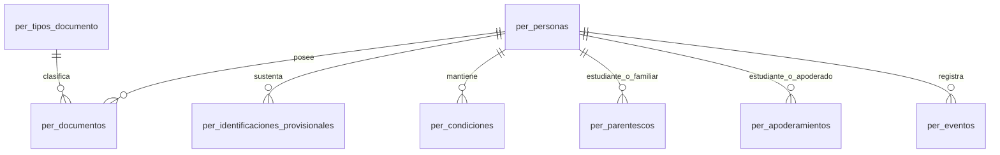

# Modelo de datos — Personas

## Diseño conceptual y lógico

Una persona física conserva un UUID estable y puede tener documentos, condiciones, parentescos y apoderamientos independientes. Apoderado se deriva de vínculos activos; el parentesco no acredita representación legal. La matriz de obligatoriedad y las reglas institucionales son fuente funcional en [ESPECIFICACION.md](ESPECIFICACION.md#3-reglas-institucionales).

## Diseño físico implementado, pendiente de aprobación arquitectónica

Fuente SQL: [V2__personas.sql](../../../../apps/erp/api/src/main/resources/db/migration/V2__personas.sql); [estándar PostgreSQL](../../ingenieria/ESTANDAR_POSTGRESQL.md). V1 permanece intacta.

### Modelo físico V2 (implementación técnica, no nueva política institucional)

La migración `V2__personas.sql` usa `erp_boston_nuevo` en desarrollo; V1 permanece intacta. La unidad de identidad es `per_personas.id` (UUID estable). Los intervalos son rangos `[inicio, fin)`; PostgreSQL 18 aplica `UNIQUE (..., periodo WITHOUT OVERLAPS)` para impedir superposiciones. `btree_gist` habilita las claves escalares del rango y `pg_trgm` la búsqueda por nombre.

| Relación física | Responsabilidad y claves | Integridad principal |
|---|---|---|
| `per_personas` | Datos comunes; `id` UUID | Nombres, apellidos, nacimiento, sexo, nacionalidad y dirección requeridos; no se expone borrado ordinario. |
| `per_tipos_documento` | Catálogo extensible; `codigo` | DNI, CE y PASAPORTE iniciales; patrón de DNI peruano de ocho dígitos. |
| `per_documentos` | Documentos históricos de una persona; `id` UUID | Tipo, país, número normalizado y período no solapados; un principal por persona en cualquier instante. |
| `per_identificaciones_provisionales` | Sustento de estudiante sin documento; `id` UUID | Solo una identificación provisional pendiente por persona; regularización sin reemplazar UUID. |
| `per_condiciones` | Períodos históricos de Estudiante, Docente y Personal institucional; `id` UUID | Períodos no solapados por persona y tipo; cierre manual con motivo. Apoderado se deriva de sus vínculos activos. |
| `per_parentescos` | Relación familiar dirigida entre estudiante y familiar; `id` UUID | Historial sin superposición de un mismo tipo de parentesco. No otorga representación legal. |
| `per_apoderamientos` | Vínculo individual estudiante–apoderado; `id` UUID | Períodos no solapados por pareja; constancia de autorización cuando no existe parentesco. |
| `per_eventos` | Trazabilidad técnica mínima; `id` UUID | Actor, acción, recurso y momento, sin copias de valores personales. |

La condición visible Apoderado se calcula a partir de los apoderamientos vigentes y activos; no se guarda un segundo estado físico. La creación de una persona y de su primera condición o vínculo ocurre en una transacción. La comprobación diferida de existencia de una condición y de documento o identificación provisional es una necesidad de integridad entre tablas que un `CHECK` local no puede satisfacer. Las operaciones concurrentes deben apoyarse además en las restricciones temporales y bloqueos de las personas involucradas.

### Diccionario de datos y relaciones

| Tabla | Columnas (además de claves foráneas indicadas) | Relación y significado |
|---|---|---|
| `per_personas` | `id` UUID PK; `nombres`, `apellidos`, `fecha_nacimiento`, `sexo`, `nacionalidad`, `telefono`, `correo`, `direccion`, `creado_en`, `actualizado_en` | Fuente única de datos personales. |
| `per_tipos_documento` | `codigo` PK, `nombre`, `patron`, `activo` | Catálogo administrable; DNI, CE y PASAPORTE iniciales. |
| `per_documentos` | `id` PK; `persona_id` FK, `tipo_codigo` FK, `pais_emisor`, `numero`, `numero_normalizado`, `principal`, `vigente_desde`, `vigente_hasta`, `periodo` generado | Historial documental. Número normalizado equivale a recorte de espacios externos. |
| `per_identificaciones_provisionales` | `id` PK; `persona_id` FK, `motivo`, `sustento_tipo`, `sustento_referencia`, `registrada_en`, `regularizada_en` | Excepción de estudiante pendiente de regularización. |
| `per_condiciones` | `id` PK; `persona_id` FK, `tipo`, `vigente_desde`, `vigente_hasta`, `cierre_manual`, `motivo_desactivacion`, `periodo` generado | Estudiante, Docente y Personal institucional; Apoderado derivado. |
| `per_parentescos` | `id` PK; `estudiante_id` y `familiar_id` FK, `tipo`, `vigente_desde`, `vigente_hasta`, `periodo` generado | Parentesco dirigido, distinto de apoderamiento. |
| `per_apoderamientos` | `id` PK; `estudiante_id` y `apoderado_id` FK, `sin_parentesco`, `autorizador`, `verificador_sub`, `medio_verificacion`, `verificado_en`, `sustento_tipo`, `sustento_referencia`, `vigente_desde`, `vigente_hasta`, `motivo_desactivacion`, `periodo` generado | Relación individual e historial. |
| `per_eventos` | `id` PK; `persona_id` FK, `recurso_id`, `accion`, `actor_sub`, `ocurrido_en` | Auditoría de metadatos, sin valores personales anteriores. |

### Restricciones e índices aplicados

| Invariante/consulta | Mecanismo SQL |
|---|---|
| Documento único por tipo, país, número e intervalo | `per_documento_unico_vigencia` con `WITHOUT OVERLAPS`; índice parcial `per_documentos_busqueda_idx` para documento abierto. |
| Un principal simultáneo por persona | Exclusión GiST `per_documento_principal_vigencia` e índice único parcial `per_documentos_principal_abierto_idx`. |
| Vigencias independientes no solapadas | `per_condicion_sin_solape`, `per_parentesco_sin_solape`, `per_apoderamiento_sin_solape`. |
| Persona con condición e identificación; apoderamiento respaldado; contacto exigido | Triggers diferidos de integridad al cierre de transacción; no se simula `CHECK` entre tablas. |
| Provisional única pendiente | `per_provisional_pendiente_idx`. |
| Búsqueda por nombre y relaciones | `per_personas_nombre_trgm_idx`, índices de condiciones vigentes, parentescos por familiar y apoderamientos en ambos sentidos. |

No hay particionamiento ni caché adicional. Los planes y mediciones locales, con su versión y límites, se registran en [PRUEBAS.md](PRUEBAS.md); no garantizan rendimiento de producción.

La normalización propuesta conserva caracteres internos y elimina solo espacios exteriores; para DNI peruano se comprueban exactamente ocho dígitos. No se eliminan caracteres de documentos extranjeros. Los criterios de formato de otros documentos siguen pendientes. La identificación provisional se fundamenta en la [norma técnica de matrícula 2026 del MINEDU](https://repositorio.minedu.gob.pe/handle/20.500.12799/11849), que contempla declaración jurada y regularización posterior; Personas registra la situación, mientras Matrículas conserva su propio trámite.

## Pendientes

Aprobar modelo físico V2 como arquitectura institucional; definir catálogos/formatos CE, pasaporte, sexo, nacionalidad y parentesco, vigencias futuras y política de retención. Los planes medidos son locales y se distinguen de las pruebas pendientes en [PRUEBAS.md](PRUEBAS.md).
