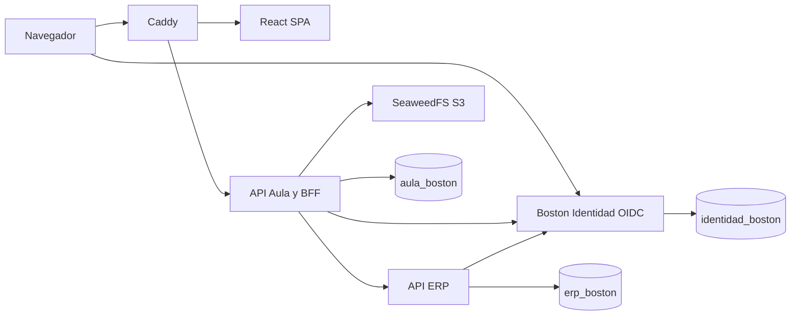

# Arquitectura general

El aula es un monolito modular Spring Boot. Identidad y ERP son aplicaciones independientes con bases propias. `api-aula` nunca consulta tablas de los otros servicios. Recibe un snapshot académico por oferta mediante el outbox de ERP y consulta tesorería por HTTP para evitar saldos duplicados.

Los identificadores de ERP son UUID estables. Las relaciones entre bases se guardan como UUID sin claves foráneas cruzadas. El control de propiedad consulta la proyección local vigente por curso. Un administrador técnico no hereda permisos para calificar ni registrar pagos.

