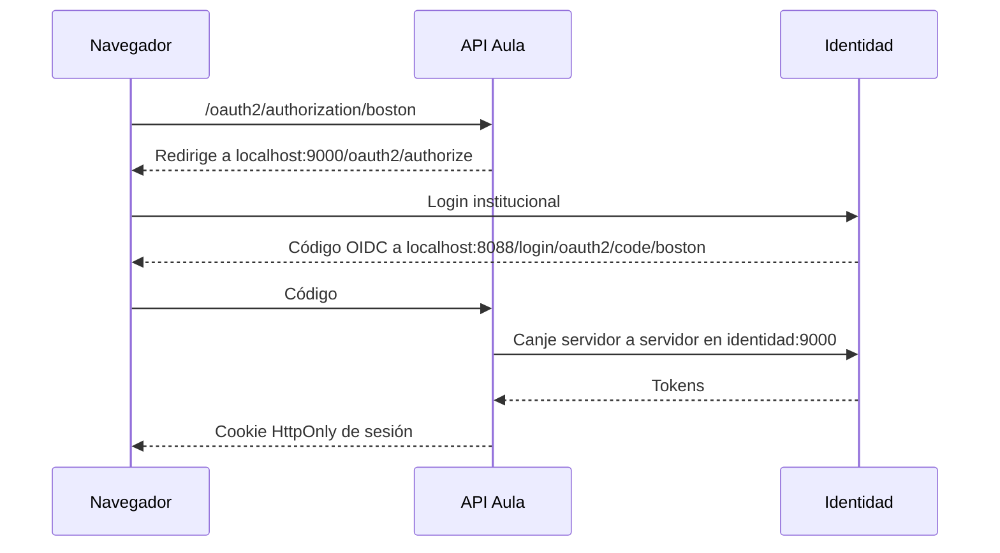

# Arquitectura local

Una instancia PostgreSQL 18 expone tres bases aisladas dentro de Docker. El puerto de PostgreSQL no se publica. `proxy` expone 8088 solo en `127.0.0.1`; `identidad` expone 9000 por la misma interfaz y SeaweedFS 8333. Caddy mantiene el frontend y BFF bajo un origen. `BOSTON_ISSUER=http://localhost:9000` es la URL del navegador; las APIs consumen token y JWKS por `identidad:9000` dentro de Docker y validan el emisor público.

Las imágenes se construyen con Java 21 y Node 24. Los contenedores de API arrancan después de los servicios de los que dependen. PostgreSQL y S3 usan volúmenes persistentes.

