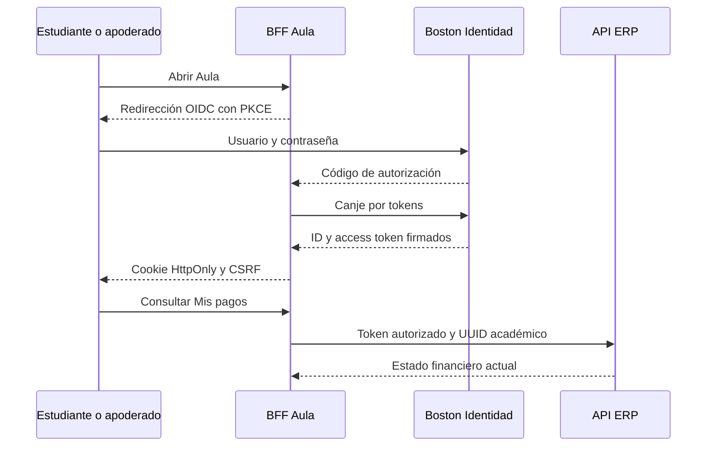
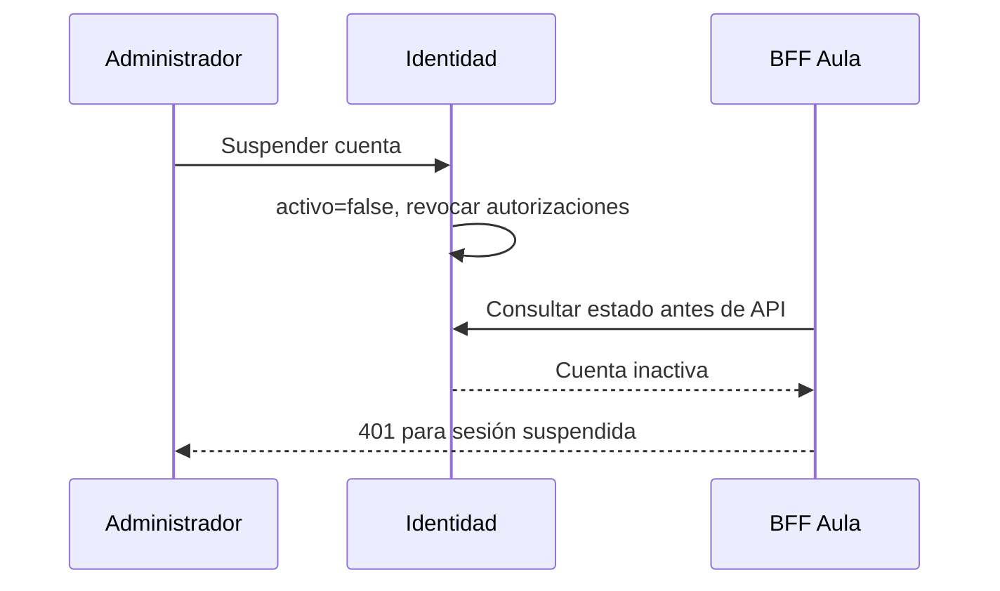

# Boston Identidad institucional

## Cuentas y vínculo institucional

La cuenta `ESTUDIANTE` se vincula con `referencia_erp` al UUID del alumno y la usan tanto él como su apoderado. La actividad realizada desde esta cuenta no distingue a las dos personas. Cada docente tiene cuenta individual con UUID docente. Coordinación y administración usan cuentas personales; coordinación recibe un ámbito de secciones asignado por administración.

En una instalación limpia `DatosIniciales` crea `estudiante.demo`, `docente.demo`, `coordinacion.demo` y `admin.demo` si no existen. La clave proviene de `SEED_PASSWORD` en `.env` y se almacena como hash Argon2id. El administrador crea cuentas adicionales desde Usuarios y accesos, indicando perfil y vínculo ERP cuando corresponde. Las cuentas administrativas nuevas no obtienen tesorería automáticamente. Solo `admin.demo` recibe de forma explícita los permisos Developer y tesorería como fixture local.

## Login, sesión y cierre

El formulario de Identidad autentica usuario y contraseña; ante error muestra un aviso sin crear sesión. El BFF de Aula usa Authorization Code con PKCE y secreto de cliente; canjea el código por tokens en el servidor. Identidad firma JWT con RSA y expone discovery/JWKS; ERP y Aula validan emisor y firma. El navegador conserva solo cookie de sesión HttpOnly SameSite=Lax y cookie CSRF; no almacena JWT ni refresh token. Cinco fallos de login bloquean 15 minutos y se registran en `auditoria_seguridad`. La sesión BFF se invalida en logout y se inicia cierre OIDC en Identidad.

## Recuperación, suspensión y permisos

Administración genera un código aleatorio de recuperación desde la pantalla de cuentas y lo entrega al titular por un canal local controlado. El titular abre `http://localhost:9000/restablecer`, introduce el código y una clave nueva de al menos 12 caracteres. La API guarda solo el hash SHA-256, muestra el código una vez y acepta un único uso durante 30 minutos. El restablecimiento revoca las autorizaciones OAuth, aumenta `sesion_version` y audita el cambio. El filtro del BFF contrasta esa versión antes de cada API y anula las sesiones abiertas con una versión anterior. No se envían correos en esta etapa.

Suspender una cuenta cambia `activo=false`, incrementa `sesion_version`, elimina sus autorizaciones OAuth y el filtro de Aula consulta estado y versión antes de servir la API; así una sesión BFF previa queda sin acceso. Activar la cuenta exige nueva autenticación. El claim `tipo` define el perfil, `referencia_erp` identifica el vínculo, `developer` habilita operaciones de diagnóstico y conservación, y `tesoreria` autoriza operaciones financieras del ERP **además** del rol administrador. La UI oculta funciones según perfil; cada servicio vuelve a comprobar permiso y propiedad del recurso.

## Secretos y paso futuro a producción

`.env` define claves locales de PostgreSQL, S3, clientes OAuth y contraseña inicial de demostración. No se usa ninguna credencial real de Boston. La clave privada RSA persiste en la base de Identidad para resistir reinicios; nunca se entrega al navegador. En producción harán falta TLS, cookies Secure, gestor de secretos, rotación de firmas, respaldos y un canal institucional verificado para recuperación. La operación local se explica en [operacion-docker.md](operacion-docker.md); las brechas pendientes están en [brechas-logica-negocio.md](brechas-logica-negocio.md).
