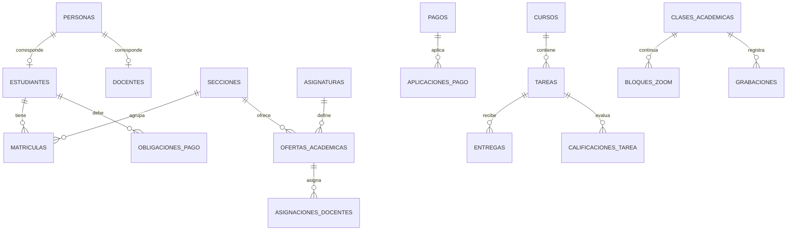

# Modelo de datos

Las migraciones son la fuente del esquema: `identidad/src/main/resources/db/migration`, `api-erp/src/main/resources/db/migration` y `api-aula/src/main/resources/db/migration`.

IDs principales: UUID. Fechas operativas: `TIMESTAMPTZ`. Importes: `NUMERIC(12,2)`. Los pagos y obligaciones tienen restricciones de positividad. Matrículas y asignaciones activas poseen índices únicos parciales. Las grabaciones guardan metadatos y clave S3, nunca MP4 en PostgreSQL. `eventos_pendientes.secuencia` ordena el outbox; `eventos_procesados` garantiza idempotencia en Aula.

## Diccionario resumido

| Servicio y tabla | Clave y campos decisivos | Regla de integridad |
|---|---|---|
| Identidad `cuentas` | `id`, `usuario`, `clave_hash`, `tipo`, `referencia_erp`, `developer`, `tesoreria`, `activo`, `sesion_version` | Usuario único; vínculo ERP único por tipo; nuevos administradores sin tesorería; la versión revoca sesiones tras restablecimiento o suspensión. |
| Identidad `recuperaciones` | `cuenta_id`, `token_hash`, `vence_en`, `usado_en` | Hash único y uso único durante 30 minutos. |
| Identidad `claves_firma` y tablas OAuth | Clave pública/privada, clientes, autorizaciones | Firma y sesiones persistentes. |
| ERP `personas`, `estudiantes`, `apoderados`, `docentes` | UUID y relación con persona | La cuenta académica corresponde al estudiante; el vínculo con apoderado se guarda en ERP. |
| ERP `periodos_academicos`, `niveles_educativos`, `grados`, `secciones`, `asignaturas`, `ofertas_academicas` | Catálogos y oferta por sección | Una oferta por sección y asignatura; periodo definido en sección. |
| ERP `matriculas`, `asignaciones_docentes` | Estado y relación con estudiante/oferta | Solo una matrícula activa por estudiante y un docente activo por oferta. |
| ERP `conceptos_cobro`, `obligaciones_pago`, `pagos`, `aplicaciones_pago` | `NUMERIC(12,2)`, vencimiento, referencia, estado | Referencia de pago única, aplicación positiva, recálculo al anular. |
| ERP `eventos_pendientes`, `auditoria_erp` | Secuencia monotónica, JSONB versionado, actor | Outbox e historial de cambios institucionales. |
| Aula `cursos`, `inscripciones_curso`, `docentes_curso`, `coordinaciones_seccion` | UUID ERP proyectados, indicador activo y ámbito | Acceso depende de inscripción/asignación/ámbito vigente. |
| Aula `tareas`, `archivos_tarea`, `entregas`, `archivos_entrega` | Estado, plazo, versión, clave S3 | Borrador privado; versiones de entrega únicas por alumno y tarea. |
| Aula `calificaciones_tarea`, `historial_calificaciones` | Valor, `version`, `entrega_version`, actor | Una nota por alumno y tarea; cada corrección conserva historia. |
| Aula `clases_academicas`, `bloques_zoom`, `grabaciones` | Clase, número de bloque, orden MP4, clave S3, estado | Una parte activa por clase y orden; partes eliminadas retienen metadatos. |
| Aula `configuraciones_modulos`, `estado_sincronizacion`, `eventos_procesados`, `registros_auditoria` | Flags, secuencia ERP, actor/acción | La desactivación no borra datos; evento aplicado una sola vez. |
| Aula `eliminaciones_grabaciones`, `preparacion_demo` | Lote, resultado, marcador `academico_v1` | Borrado auditado y fixtures insertados una sola vez. |

Cada servicio mantiene su propio esquema lógico dentro de una base independiente. Los UUID que cruzan servicios son referencias externas sin FK entre bases. Las migraciones V4–V6 del Aula vinculan la nota a la entrega calificada, permiten reutilizar el orden de MP4 eliminado y registran la preparación de datos demo.

